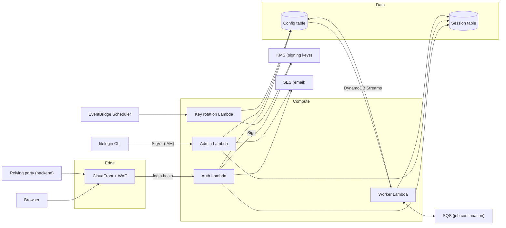

# Architecture

This document describes the runtime architecture for LiteLogin: a multi-tenant OAuth 2.1 / OpenID Connect identity provider built on AWS Lambda and DynamoDB. The tables, keys and access patterns are specified in [Datamodel.md](Datamodel.md).

This repository contains:
- the identity provider itself
- the background jobs it depends on
- a basic admin API
- the `litelogin` CLI, which calls that API

## Goals

- **Serverless.** There are no servers or containers to manage, and costs scale with requests (close to zero when idle).
- **Multi-tenant.** Many orgs, clients and login hosts share one deployment. Each request is scoped to a tenant by the login host it arrives on.
- **Low latency.** Every request is a handful of single-item DynamoDB reads. Configuration reads are cached in memory.
- **Secure by default.** Signing keys never leave KMS, every stored credential is hashed, and revocation takes effect immediately.

## Components



| Component | Responsibility |
| -- | -- |
| CloudFront | TLS termination for default and custom login hosts, WAF, forwarding the viewer's host to Lambda, and caching discovery and JWKS responses |
| AWS WAF | Rate limiting per IP on credential endpoints, AWS managed rule sets, optional bot control |
| Auth Lambda | Every browser-facing and OIDC endpoint (see [Endpoints](#endpoints)) |
| Admin Lambda | Basic management API for orgs, pools, clients, login hosts and users (see [Admin API](#admin-api)), on its own function URL with IAM authentication |
| `litelogin` CLI | Command-line client for the admin API, including bootstrapping a new deployment |
| Worker Lambda | Asynchronous jobs triggered by Config table changes: revocation cleanup, pool deletion, custom domain verification |
| Key rotation Lambda | Signing key rotation on a schedule (see "Rotate signing keys" in the data model) |
| DynamoDB | Config table (orgs, clients, pools, users, hosts, keys) and Session table (sessions, codes, refresh tokens, one-time tokens) |
| DynamoDB Streams | Change feed on the Config table that triggers the Worker Lambda, whether the change came from the Auth Lambda or the Admin Lambda |
| KMS | Asymmetric RSA signing keys. Private keys never leave KMS. |
| SES | Verification, password reset and email change messages |
| SQS | Continuation queue for jobs too large for one invocation (e.g. deleting a large pool), with a dead-letter queue |
| EventBridge Scheduler | Triggers key rotation, and polls custom domains that are waiting for verification |

## Request routing

### Login hosts and TLS

- **Default hosts** (`*.litelogin.com`) are served by one CloudFront distribution with a wildcard ACM certificate.
- **Custom hosts** (e.g. `login.acme.com`) need a certificate each. Use CloudFront's multi-tenant distributions (CloudFront SaaS Manager): each custom host becomes a distribution tenant with its own managed certificate. The customer adds a CNAME to LiteLogin, and certificate validation doubles as the domain-ownership check behind "Verify custom host".
- Before relying on it, check the per-account limits on tenants and certificates against the expected number of custom domains.

### Forwarding the login host

The data model resolves every request from its host. Lambda never sees the viewer's `Host` header directly, so:

1. A CloudFront Function on viewer request copies the normalized `Host` into `x-litelogin-host`, overwriting any value the viewer sent.
2. The Auth Lambda reads the host only from `x-litelogin-host`, and never from `Host` or `X-Forwarded-Host`.

### Origin: Lambda function URLs

- **Origin:** CloudFront forwards to Lambda function URLs. API Gateway would add cost and latency without adding anything we need, because routing happens inside the function and WAF runs at CloudFront.
- **Why not OAC:** CloudFront Origin Access Control isn't used here. With OAC, function URLs require the viewer to send a SHA-256 hash of every POST body, and browsers submitting login forms don't.
- **Locking down the URLs:** function URLs use `AuthType: NONE`. CloudFront adds a secret origin header, and the Lambda rejects any request without it, so the function URL can't be called directly to bypass WAF. The secret lives in Secrets Manager, rotates, and the Lambda accepts both the current and previous value during rotation.

### Caching at the edge

| Path | CloudFront cache |
| -- | -- |
| `/.well-known/openid-configuration` | 5 minutes, keyed on host |
| `/.well-known/jwks.json` | 5 minutes, same response for every host |
| Everything else | Not cached; all headers, cookies and query strings forwarded |

## Endpoints

All of these are served by the Auth Lambda on every login host.

| Endpoint | Method | Purpose |
| -- | -- | -- |
| `/.well-known/openid-configuration` | GET | Discovery; `issuer = https://{host}` |
| `/.well-known/jwks.json` | GET | Public signing keys |
| `/authorize` | GET | Start authorization; reuse the session or show login |
| `/login` | GET, POST | Login form |
| `/register` | GET, POST | Registration form (if `registration_enabled`) |
| `/verify-email` | GET | Confirm an email verification link |
| `/password/forgot` | GET, POST | Request a password reset |
| `/password/reset` | GET, POST | Complete a password reset |
| `/token` | POST | Authorization code and refresh token grants |
| `/userinfo` | GET, POST | User claims for an access token |
| `/logout` | GET, POST | RP-initiated logout |
| `/account/*` | GET, POST | Signed-in user: change password, change email, sessions |

**CORS:** `/token`, `/userinfo` and `/.well-known/*` allow cross-origin requests so that browser-based (public) clients can call them. The allowed origins come from the client's `redirect_uris`.

The admin API is served separately by the Admin Lambda (see [Admin API](#admin-api)). It isn't reachable on login hosts.

## Admin API

A basic JSON management API. It implements the "Admin" access patterns in [Datamodel.md](Datamodel.md), including their transactions and `version` conditions.

### Access

- **Its own function URL, with IAM auth.** The Admin Lambda has its own function URL with `AuthType: AWS_IAM`, and isn't behind CloudFront. Every request must be SigV4-signed by an IAM principal that has `lambda:InvokeFunctionUrl` on the function.
- **Callers:**
  - the CLI uses the operator's AWS credentials
  - other management tools use an IAM role
  - a caller in another AWS account is allowed through the function's resource-based policy
- **Why IAM:**
  - There's no bootstrap problem: the first org can be created with AWS credentials before any LiteLogin user exists.
  - There's no API secret to issue or rotate.
  - Access is controlled the same way as the rest of the AWS account.
- **Audit logging:** every request that changes data logs the caller's IAM principal ARN, taken from the function URL request context.

### Resources

| Resource | Operations |
| -- | -- |
| `/v1/orgs` | Create |
| `/v1/orgs/{org}` | Get, update, suspend, reactivate |
| `/v1/orgs/{org}/pools` | Create, list |
| `/v1/pools/{pool}` | Get, update, delete (asynchronous; returns `202`) |
| `/v1/orgs/{org}/clients` | Create (returns the client secret once), list |
| `/v1/clients/{client}` | Get, update, disable, enable, delete |
| `/v1/clients/{client}/secret` | Rotate (returns the new secret once) |
| `/v1/clients/{client}/hosts` | List, add |
| `/v1/clients/{client}/hosts/{host}` | Get (including verification status), remove |
| `/v1/pools/{pool}/users` | Create (with an initial password, or by emailing a password-set link), list, search by `email_prefix` |
| `/v1/users/{user}` | Get, update, disable, enable, delete |
| `/v1/users/{user}/sessions` | List, revoke all (increments `auth_version`) |
| `/v1/keys` | List signing keys and their status |

### Conventions

- **Versioning:** the API is versioned in the path (`/v1`). Changes within a version are additive only.
- **Optimistic locking:** `GET` returns the item's `version` as an `ETag`. Updates must send `If-Match`, and a mismatch returns `412`.
- **Pagination:** list endpoints take `limit` and an opaque `cursor`. The cursor is the encoded DynamoDB `LastEvaluatedKey`, signed so callers can't change it.
- **Errors:** JSON `{ "error": "<code>", "message": "<text>" }` with standard HTTP status codes.
- **Secrets are returned only once.** Client secrets appear only in create and rotate responses, and are stored only as hashes. Password hashes are never returned.

## CLI

The `litelogin` CLI lives in this repository and is a thin client for the admin API. It signs requests with the standard AWS credential chain (`--profile`, environment variables, IAM Identity Center). It finds the admin API URL from `--endpoint`, a config file, or the deployed stack's outputs.

```sh
# Bootstrap a new deployment: org, pool, client and default login host.
# Prints the issuer URL, client ID and client secret.
litelogin init --org "Acme" --client "Acme Portal" --redirect-uri https://app.acme.com/callback

litelogin client create --org {org} --name "Mobile app" --type public --redirect-uri com.acme.app:/callback
litelogin host add --client {client} login.acme.com
litelogin host status --client {client} login.acme.com
litelogin user create --pool {pool} --email admin@acme.com --invite
litelogin user revoke-sessions {user}
```

## Management integration

The admin API is the contract between LiteLogin and every management tool, including the CLI.

- **No direct table access.** Management tools don't write to the tables. The data model stays internal to LiteLogin, so it can change without breaking them.
- **Tools handle their own users.** A tool with its own users authenticates them, decides what each one is allowed to do, and calls the admin API with its IAM role.
- **Background work runs off the change stream.** The Worker Lambda consumes the Config table's DynamoDB stream, so it doesn't matter whether a change came from the Auth Lambda or the Admin Lambda:

  | Change in the Config table | Worker action |
  | -- | -- |
  | User `auth_version` increases (or user deleted) | Revocation cleanup |
  | Pool `status` set to `deleting` | Pool deletion |
  | Login host created with `status=pending` | Start custom domain onboarding and verification |
  | Login host deleted | Remove its CloudFront tenant |

- **Changes reach the Auth Lambda through cache expiry.** It caches config for 30–60 seconds, so admin changes take effect within that time.

## Lambda design

- **One function per trust boundary.** The Auth Lambda handles all public endpoints behind an internal router: one deployment, shared warm caches, and fewer cold starts. The admin, worker and rotation functions are separate because they need different IAM permissions.
- **Least-privilege IAM:**

  | Function | DynamoDB | KMS | Other |
  | -- | -- | -- | -- |
  | Auth | Read/write both tables | `Sign` on signing keys | `ses:SendEmail` |
  | Admin | Read/write Config table; on the Session table, query GSI1 and write `OTT` items | None | `ses:SendEmail` |
  | Worker | Read/write both tables; read the Config table stream | None | `sqs:SendMessage`/`ReceiveMessage`/`DeleteMessage` on its continuation queue; CloudFront tenant management |
  | Key rotation | Read/write `KEYS` items | `CreateKey`, `GetPublicKey`, `ScheduleKeyDeletion` | None |

- **arm64 (Graviton).** It's cheaper per millisecond than x86.
- **Memory sized for argon2id.** Password hashing is the most expensive operation, and Lambda CPU scales with memory. Start the Auth Lambda at 1024 MB and tune it with load tests so that a password verification takes about 50–150 ms.
- **In-memory caches,** per execution environment:
  - Config items (`LOGIN_HOST`, `ORG`, `CLIENT`, `POOL`): 30–60 seconds
  - The active signing key ID: 5 minutes
  - The origin secret: 5 minutes
- **Timeouts:** 10 seconds for the Auth and Admin Lambdas. Background functions get longer timeouts, sized to their job.
- **Cold starts:** keep dependencies small. If p99 latency matters, add provisioned concurrency to the Auth Lambda.

## Background jobs

| Job | Trigger | Notes |
| -- | -- | -- |
| Revocation cleanup | Config stream: user `auth_version` increased or user deleted | Deletes stale sessions and refresh families through GSI1. Must be idempotent and safe to retry. |
| Pool deletion | Config stream: pool `status` set to `deleting` | Pages through the pool's users, using the SQS continuation queue to carry on across invocations |
| Custom domain onboarding | Config stream: login host created with `status=pending` | Creates the CloudFront tenant and certificate |
| Custom domain verification | EventBridge Scheduler (e.g. every 5 minutes while any host is `pending`) | Marks the host `verified` once the certificate is issued |
| Signing key rotation | EventBridge Scheduler (e.g. daily check, rotate every 90 days) | Prepare, activate and remove, as described in the data model |

- **Stream processing:** the stream's event source mapping uses filter criteria, so the Worker is only invoked for the changes above. It also has a failure destination (an SQS dead-letter queue) and bisects batches on error, so one bad record can't block the stream.
- **Retention:** stream records are kept for 24 hours. A Worker outage longer than that loses cleanup jobs, but not revocations, which have already taken effect.
- **Dead-letter queues:** every queue has one, with an alarm.
- **Revocation never waits on a job.** It is the synchronous `auth_version` increment.

## Data

- **Capacity:** on-demand for both tables.
- **Config table:** point-in-time recovery and deletion protection enabled. DynamoDB Streams enabled with `NEW_AND_OLD_IMAGES`, so the Worker can see what changed.
- **Session table:** TTL on `expires_at`; deletion protection enabled. Point-in-time recovery is optional, since restoring stale sessions has little value.
- **Encryption:** both tables use a customer managed KMS key, so access can be audited and revoked.
- **Region:** single region for v1. Multi-region is a later decision; it would need DynamoDB global tables with multi-region strong consistency, because single-use codes and refresh token rotation depend on strongly consistent reads.

## Email

- Send through SES from the Auth Lambda, inline with the request.
- Default sender: `no-reply@litelogin.com`. Per-org sending domains would need SES domain verification per org (future).
- Configure an SES configuration set, and handle bounces and complaints so the account's sending reputation is protected.
- Production SES access must be requested before launch, because new accounts start in the SES sandbox.

## Security

- **Edge:**
  - WAF rate-based rules per IP on `/login`, `/register`, `/password/*` and `/token`, plus AWS managed rule groups.
  - TLS 1.2 minimum.
  - HSTS on every host.
- **Cookies:**
  - The session cookie is host-only, with `HttpOnly`, `Secure` and `SameSite=Lax`, using the `__Host-` prefix.
  - Every POST form carries a CSRF token tied to the session or a pre-login cookie.
- **Response headers:**
  - A strict `Content-Security-Policy` on HTML pages, plus `frame-ancestors 'none'` to prevent clickjacking.
  - `Cache-Control: no-store` on all `/token` responses and authenticated pages.
- **Secrets:** the origin secret is in Secrets Manager. There are no long-lived credentials in environment variables.
- **Logging:** never log passwords, tokens, codes, cookies or client secrets. Log hashed identifiers instead.

## Observability

- **Logs:** structured JSON with a request ID, org ID and client ID on every line. Use CloudWatch Logs with a retention policy.
- **Metrics** (CloudWatch embedded metric format):
  - logins succeeded and failed
  - lockouts
  - tokens issued
  - refresh token reuse detected
  - authorization code reuse detected
  - KMS `Sign` latency and throttling
- **Alarms:** Lambda errors and throttles, DynamoDB throttles, KMS throttling, dead-letter queue depth, and spikes in refresh token reuse.
- **Tracing:** AWS X-Ray on the Auth Lambda.

## Quotas to check before launch

| Service | Quota |
| -- | -- |
| KMS | Cryptographic operations per second for RSA `Sign` (shared per account and region) |
| Lambda | Account concurrency limit (1,000 by default) |
| SES | Sending rate and daily quota; leave the sandbox |
| CloudFront | Distribution tenants and certificates for custom domains |
| WAF | Rate-based rule granularity and minimum evaluation window |

## Environments and deployment

- Separate AWS accounts for `dev`, `staging` and `prod`.
- All infrastructure as code. A CI pipeline runs tests, deploys to staging, runs smoke tests against the OIDC endpoints, then promotes to prod.
- Lambda versions and aliases, with gradual deployment (e.g. CodeDeploy linear traffic shifting) and automatic rollback on alarms.

## Open decisions

1. **Runtime language.** TypeScript on Node.js has the largest OIDC/JOSE ecosystem. Go or Rust have faster cold starts and cheaper CPU-bound argon2id. Pick one before writing handlers.
2. **Infrastructure as code tool.** AWS CDK, AWS SAM or Terraform.
3. **Custom domain onboarding.** Confirm that CloudFront SaaS Manager fits the expected number of custom domains and the onboarding flow. The fallback is one distribution per custom domain, or per batch of domains.
4. **Production region.**
5. **Listing orgs.** The data model has no access pattern for listing all orgs, so the admin API can't offer `GET /v1/orgs` without a Scan. A small deployment could accept the Scan. A larger one would need a sparse GSI on org items.
