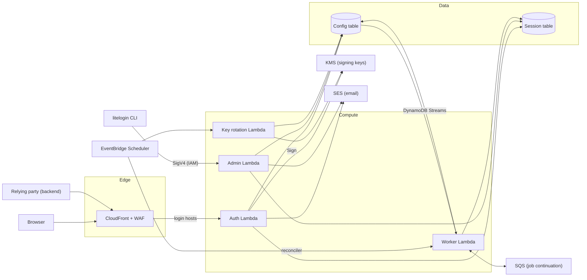

# Architecture

This document describes the runtime architecture for LiteLogin: a multi-tenant OAuth 2.1 / OpenID Connect identity provider built on AWS Lambda and DynamoDB. The tables, keys and access patterns are specified in [Datamodel.md](Datamodel.md).

This repository contains:
- the identity provider itself
- the background jobs it depends on
- a basic admin API
- the `litelogin` CLI, which calls that API

## Goals

- **Serverless.** There are no servers or containers to manage, and costs scale with requests (close to zero when idle).
- **Multi-tenant.** Many orgs, clients and login hosts share one deployment. Each request is scoped to a tenant by the login host it arrives on.
- **Low latency.** Every request is a handful of single-item DynamoDB reads. Configuration reads are cached in memory.
- **Secure by default.** Signing keys never leave KMS and every stored credential is hashed. Sessions, authorization codes and refresh tokens are revoked immediately. Access tokens that were already issued stay valid until they expire (see [Revocation guarantees](#revocation-guarantees)).

## Components



| Component | Responsibility |
| -- | -- |
| CloudFront | TLS termination for default and custom login hosts, WAF, forwarding the viewer's host to Lambda, and caching discovery and JWKS responses |
| AWS WAF | Rate limiting per IP on credential endpoints, AWS managed rule sets, optional bot control |
| Auth Lambda | Every browser-facing and OIDC endpoint (see [Endpoints](#endpoints)) |
| Admin Lambda | Basic management API for orgs, pools, clients, login hosts and users (see [Admin API](#admin-api)), on its own function URL with IAM authentication |
| `litelogin` CLI | Command-line client for the admin API, including bootstrapping a new deployment |
| Worker Lambda | Background jobs (revocation cleanup, pool deletion, custom domain onboarding and removal). Config table changes start them; a scheduled reconciler retries any that stall. |
| Key rotation Lambda | Signing key rotation on a schedule (see "Rotate signing keys" in the data model) |
| DynamoDB | Config table (orgs, clients, pools, users, hosts, keys) and Session table (sessions, codes, refresh tokens, one-time tokens) |
| DynamoDB Streams | Change feed on the Config table that triggers the Worker Lambda, whether the change came from the Auth Lambda or the Admin Lambda |
| KMS | Asymmetric RSA signing keys. Private keys never leave KMS. |
| SES | Verification, password reset and email change messages |
| SQS | Continuation queue for jobs too large for one invocation (e.g. deleting a large pool), with a dead-letter queue |
| EventBridge Scheduler | Triggers key rotation and the Worker's reconciler |

## Request routing

### Login hosts and TLS

- **Hosts belong to orgs.** Every org has a default host, `{label}.login.example.com`, created with it; it can add custom hosts. A host serves one user pool, and the org's clients on that pool can be put on it. A host is the sign-on boundary: its sessions, theme, sign-up setting and session lifetimes are shared by every client on it, while each client keeps its own redirect URIs, scopes, grants, PKCE setting, token lifetimes and credentials (Datamodel.md, Decision 8).
- **Default hosts** (`*.login.example.com`) are served by one CloudFront distribution with a wildcard ACM certificate.
- **Custom hosts** (e.g. `login.acme.com`) need a certificate each. Use CloudFront's multi-tenant distributions (CloudFront SaaS Manager): each custom host becomes a distribution tenant with its own managed certificate. The customer adds one CNAME, to the routing endpoint of the connection group that serves the tenants. The certificate is validated over HTTP through that CNAME (CloudFront serves the validation token), so certificate validation doubles as the domain-ownership check. The multi-tenant distribution serves requests just as the default hosts' distribution does: same origin, origin secret, policies, host function and WAF.
- **When a custom host is verified:** the host becomes `verified` only when both checks pass: the certificate has been issued, and the CNAME resolves to LiteLogin. A valid certificate alone doesn't prove that traffic will route correctly.
- **Removing a custom host:** only a host with no clients left can be removed (an org's default host can't be). It's set to `removing` and stops serving within the config cache's lifetime (30 seconds). The Worker then disables its CloudFront tenant, deletes it once the change has deployed (the reconciler calls back for that), deletes its managed certificate (CloudFront leaves it behind once it's no longer in use), and deletes the host items last, so a failed removal can't leave orphaned resources behind.
- Before relying on it, check the per-account limits on tenants and certificates against the expected number of custom domains.

### Forwarding the login host

The data model resolves every request from its host. Lambda never sees the viewer's `Host` header directly, so:

1. A CloudFront Function on viewer request copies the normalized `Host` into `x-litelogin-host`, overwriting any value the viewer sent.
2. The Auth Lambda reads the host only from `x-litelogin-host`, and never from `Host` or `X-Forwarded-Host`.

### Origin: Lambda function URLs

- **Origin:** CloudFront forwards to Lambda function URLs. API Gateway would add cost and latency without adding anything we need, because routing happens inside the function and WAF runs at CloudFront.
- **Why not OAC:** CloudFront Origin Access Control isn't used here. With OAC, function URLs require the viewer to send a SHA-256 hash of every POST body, and browsers submitting login forms don't.
- **Locking down the URLs:** function URLs use `AuthType: NONE`. CloudFront adds a secret origin header (`X-Litelogin-Origin-Secret`), and the Lambda rejects any request without it, so the function URL can't be called directly to bypass WAF.
  - Terraform generates two secrets, `a` and `b`, and CloudFront sends the active one. The Lambda accepts both, so the secret rotates without downtime: replace the inactive secret, deploy, switch `active_origin_secret` to it, and deploy again.
  - The Lambda's environment holds only the secrets' SHA-256 hashes, so its configuration doesn't hold anything that lets you call it directly.
  - The secret isn't in Secrets Manager. CloudFront's origin configuration holds it in plain text anyway, and refreshing a Secrets Manager secret value needs `GetSecretValue`, which the read-only plan role doesn't have.

### Caching at the edge

| Path | CloudFront cache |
| -- | -- |
| `/.well-known/openid-configuration` | 5 minutes, keyed on host |
| `/.well-known/jwks.json` | 5 minutes, same response for every host |
| `/token`, `/userinfo` | Not cached (responses are `no-store`). CloudFront forwards `Authorization` only as part of a cache key, so these paths have a cache policy that includes it. |
| Everything else | Not cached; cookies, query strings and the headers the Lambda uses are forwarded |

## Endpoints

All of these are served by the Auth Lambda on every login host.

| Endpoint | Method | Purpose |
| -- | -- | -- |
| `/.well-known/openid-configuration` | GET, OPTIONS | Discovery; `issuer = https://{host}` |
| `/.well-known/jwks.json` | GET, OPTIONS | Public signing keys |
| `/authorize` | GET | Start authorization; reuse the session or show login |
| `/login` | GET, POST | Login form |
| `/register` | GET, POST | Registration form (if the host's `registration_enabled`) |
| `/verify-email` | GET | Confirm an email verification link |
| `/password/forgot` | GET, POST | Request a password reset |
| `/password/reset` | GET, POST | Complete a password reset |
| `/token` | POST, OPTIONS | Authorization code and refresh token grants |
| `/userinfo` | GET, POST, OPTIONS | User claims for an access token |
| `/logout` | GET, POST | RP-initiated logout |
| `/account/*` | GET, POST | Signed-in user: change password, change email (confirmed by a link to the new address), list sessions, sign one out, sign out everywhere |

**CORS:**
- `/.well-known/*` is public and allows any origin.
- `/token` and `/userinfo` allow only the origins in the request's client's `allowed_origins`. These are configured separately from `redirect_uris`, because a redirect URI isn't an origin (native apps, for example, use custom schemes).
- Preflight `OPTIONS` requests carry no `client_id`, so they're allowed for the `allowed_origins` of every client on the login host. The response to the request itself then allows only its own client's origins. Requests from any other origin get no CORS headers.

The admin API is served separately by the Admin Lambda (see [Admin API](#admin-api)). It isn't reachable on login hosts.

## Protocol

LiteLogin implements the OAuth 2.1 authorization code flow and OpenID Connect Core. The rules below are enforced by the access patterns in [Datamodel.md](Datamodel.md).

### Clients

| Requirement | Public client | Confidential client |
| -- | -- | -- |
| PKCE (`S256`) | Required | Required, unless the client opts out (`require_pkce=false`) |
| Client secret | None | Required (`client_secret_basic` or `client_secret_post`) |
| Redirect URI matching | Exact string match | Exact string match |
| Authorization code | Single use, 60-second lifetime | Single use, 60-second lifetime |
| Refresh tokens | Rotated on every use | Rotated on every use |

Authorization codes are bound to the client, the redirect URI, the PKCE challenge, the issuer and the user's `auth_version`. `state` is returned unchanged, and `nonce` is copied into the ID token. The implicit and password grants aren't supported.

- **Authorization responses** carry `iss` (RFC 9207). Errors are redirected to the client only once `client_id` and `redirect_uri` are known to be valid; before that, they're shown on a page.
- **Scopes:** scopes the client isn't allowed are dropped rather than rejected (RFC 6749 §3.3), and the token response says what was granted. `openid` is required.
- **Refresh tokens** are issued to every client whose `grant_types` include `refresh_token`; `offline_access` isn't required.
- **Signing in during authorization:** without a usable session, `/authorize` sends the browser to `/login`, carrying the request's query. After signing in, the browser returns to the same `/authorize` request. `prompt=login` and `max_age` are removed at that point, since the user just signed in.
- **`prompt`:** `none` and `login` are supported. There's no consent screen: clients are configured by the operator, so `consent` is accepted and has no effect.
- **RP-initiated logout:** `/logout` checks `id_token_hint` and `client_id` against the host's client, and `post_logout_redirect_uri` against its registered URIs. The user confirms before being signed out, so another site can't sign them out with a link.
- **Pages' `form-action`** allows the client's redirect and post-logout redirect URI origins, because browsers apply it to the redirects that follow a form submission.

### Tokens

| | Access token | ID token | Refresh token |
| -- | -- | -- | -- |
| Format | JWT, `typ: at+jwt` (RFC 9068) | JWT (OIDC Core) | Opaque random value |
| Signing | RS256, `kid` in header | RS256, `kid` in header | Not signed; stored hashed |
| Lifetime | `access_token_ttl` (default 15 minutes) | `id_token_ttl` (default 15 minutes) | `refresh_token_ttl`, capped by the family's lifetime |
| Claims | `iss`, `sub`, `aud`, `client_id`, `scope`, `exp`, `iat`, `jti` | `iss`, `sub`, `aud`, `azp`, `exp`, `iat`, `auth_time`, `nonce`, `amr`; plus `email` and `email_verified` with the `email` scope | n/a |
| Validated by | The relying party, locally with the JWKS | The relying party, locally with the JWKS | LiteLogin only |

- **Minimal claims:** access tokens carry no email or profile data. Relying parties that need it call `/userinfo` or read the ID token.
- **Audience:** `aud` is the client ID for both token types until resource indicators (RFC 8707) are supported.
- **No `auth_version` claim:** relying parties can't check it, so it isn't included.

### Revocation guarantees

| What is revoked | When it takes effect |
| -- | -- |
| Browser session | Immediately |
| Unredeemed authorization code | Immediately |
| Refresh token family | Immediately |
| Access token or ID token already issued | When it expires, at most `access_token_ttl` later |

Access tokens are validated locally by relying parties, so LiteLogin can't revoke one before it expires. That's why the default lifetime is short. A token introspection endpoint (RFC 7662) would allow immediate revocation for relying parties willing to make an online check. It isn't part of v1.

## Admin API

A basic JSON management API. It implements the "Admin" access patterns in [Datamodel.md](Datamodel.md), including their transactions and `version` conditions.

### Access

- **Its own function URL, with IAM auth.** The Admin Lambda has its own function URL with `AuthType: AWS_IAM`, and isn't behind CloudFront. Every request must be SigV4-signed by an IAM principal that has `lambda:InvokeFunctionUrl` on the function.
- **Callers:**
  - the CLI uses the operator's AWS credentials
  - other management tools use an IAM role
  - a caller in another AWS account is allowed through the function's resource-based policy
- **Why IAM:**
  - There's no bootstrap problem: the first org can be created with AWS credentials before any LiteLogin user exists.
  - There's no API secret to issue or rotate.
  - Access is controlled the same way as the rest of the AWS account.
- **Audit logging:** every request that changes data logs the caller's IAM principal ARN, taken from the function URL request context.

### Who it's for

The admin API is for deployment operators.
- **Full access:** any IAM principal allowed to call it can manage every org. There are no per-org grants, and IAM authentication isn't tenant authorization.
- **Tools enforce their own permissions:** a tool that serves per-org administrators must decide what each of its users can do before it calls the admin API.
- **Granting and revoking access:** both happen in IAM, either on the principal's policy or on the function's resource-based policy.

### Resources

| Resource | Operations |
| -- | -- |
| `/v1/orgs` | Create (with its default pool and default login host), list (oldest first) |
| `/v1/orgs/{org}` | Get, update, suspend, reactivate |
| `/v1/orgs/{org}/pools` | Create, list |
| `/v1/pools/{pool}` | Get, update, delete (asynchronous; returns `202`) |
| `/v1/orgs/{org}/clients` | Create on an existing login host of the org (returns the client secret once), list |
| `/v1/clients/{client}` | Get, update, disable, enable, delete |
| `/v1/clients/{client}/secret` | Rotate (returns the new secret once) |
| `/v1/clients/{client}/hosts` | List the client's login hosts |
| `/v1/orgs/{org}/hosts` | List, add a custom host |
| `/v1/hosts/{host}` | Get (including verification status), update settings (theme, registration, session lifetimes), remove (a custom host with no clients) |
| `/v1/hosts/{host}/clients` | List the host's clients |
| `/v1/hosts/{host}/clients/{client}` | Add (`PUT`, idempotent) or remove (`DELETE`; not the client's last host) |
| `/v1/pools/{pool}/users` | Create (with an initial password, or by emailing a password-set link), list, search by `email_prefix` |
| `/v1/users/{user}` | Get, update, disable, enable, delete |
| `/v1/users/{user}/sessions` | List, revoke all (increments `auth_version`) |
| `/v1/keys` | List signing keys and their status |

### Conventions

- **Versioning:** the API is versioned in the path (`/v1`). Changes within a version are additive only.
- **Optimistic locking:** `GET` returns the item's `version` as an `ETag`. Updates must send `If-Match`, and a mismatch returns `412`.
- **Pagination:** list endpoints take `limit` and an opaque `cursor`. The cursor is the encoded DynamoDB `LastEvaluatedKey`, bound to its listing (e.g. the pool and `email_prefix`) and signed with a KMS HMAC key, so callers can't change it or use it for another listing. The key never leaves KMS. The org and user lists are paginated; the other lists (an org's pools, clients and hosts, a host's clients, a client's hosts, signing keys) are small and return every item, and they gain a `next_cursor` the same way if they grow.
- **Idempotency:** create requests and other important changes accept an `Idempotency-Key` header. A retry with the same key and body returns the original response, so a lost response can't create a duplicate. Keys are scoped per caller and kept for 24 hours. The CLI sends one on every create. Client secrets aren't stored with the response: a replayed "create client" response has no secret, and the caller rotates it if the original response was lost.
- **Errors:** JSON `{ "error": "<code>", "message": "<text>" }` with standard HTTP status codes. A missing `If-Match` is `428`, a stale one `412`, and unknown request fields are rejected with `400`, so a misspelled field fails instead of being ignored.
- **Actions:** suspend, reactivate, disable, enable and rotate-secret are `POST` to a sub-path (e.g. `POST /v1/clients/{client}/disable`). They accept `If-Match` but don't require it. Revoking a user's sessions is `DELETE /v1/users/{user}/sessions`.
- **Secrets are returned only once.** Client secrets appear only in create and rotate responses, and are stored only as hashes. Password hashes are never returned.

## CLI

The `litelogin` CLI lives in this repository and is a thin client for the admin API. It signs requests with the standard AWS credential chain (`--profile`, environment variables, IAM Identity Center). It finds the admin API URL from `--endpoint`, a config file, or the deployed stack's outputs.

```sh
# Bootstrap a new deployment: an org (with its default pool and default
# login host, acme.login.example.com) and a client on that host.
# Prints the issuer URL, client ID and client secret.
litelogin init --org "Acme" --client "Acme Portal" --redirect-uri https://app.acme.com/callback

# A second client on the same host: one sign-in serves both.
litelogin client create --org {org} --host acme.login.example.com --name "Mobile app" --type public --redirect-uri com.acme.app:/callback
litelogin host update acme.login.example.com --theme brand_name=Acme --registration=false
litelogin host add --org {org} login.acme.com
litelogin host status login.acme.com
litelogin host add-client login.acme.com {client}
litelogin user create --pool {pool} --email admin@acme.com --invite
litelogin user revoke-sessions {user}
```

## Management integration

The admin API is the contract between LiteLogin and every management tool, including the CLI.

- **No direct table access.** Management tools don't write to the tables. The data model stays internal to LiteLogin, so it can change without breaking them.
- **Tools handle their own users.** A tool with its own users authenticates them, decides what each one is allowed to do, and calls the admin API with its IAM role.
- **Background work runs off the change stream.** The Worker Lambda consumes the Config table's DynamoDB stream, so it doesn't matter whether a change came from the Auth Lambda or the Admin Lambda:

  | Change in the Config table | Worker action |
  | -- | -- |
  | User `auth_version` increases (or user deleted) | Revocation cleanup |
  | Pool `status` set to `deleting` | Pool deletion |
  | Login host created with `status=pending` | Start custom domain onboarding and verification |
  | Login host set to `status=removing` | Remove its CloudFront tenant, then delete the host items |

- **Changes reach the Auth Lambda through cache expiry.** It caches config for 30–60 seconds, so admin changes take effect within that time (see [Configuration caching](#configuration-caching)).

## Lambda design

- **One function per trust boundary.** The Auth Lambda handles all public endpoints behind an internal router: one deployment, shared warm caches, and fewer cold starts. The admin, worker and rotation functions are separate because they need different IAM permissions.
- **Least-privilege IAM:**

  | Function | DynamoDB | KMS | Other |
  | -- | -- | -- | -- |
  | Auth | Read/write both tables | `Sign` on signing keys | `ses:SendEmail` |
  | Admin | Read/write Config table; on the Session table, query GSI1 and read/write `OTT` and `IDEMPOTENCY` items | `GenerateMac`/`VerifyMac` on its cursor key | `ses:SendEmail` |
  | Worker | Read/write both tables, including Config GSI2; read the Config table stream | None | `sqs:SendMessage`/`ReceiveMessage`/`DeleteMessage` on its continuation queue; CloudFront tenant management |
  | Key rotation | Read/write `KEYS` items | `CreateKey` (`RSA_2048` and `SIGN_VERIFY` only, with this environment's tags), `GetPublicKey`, `ScheduleKeyDeletion` | None |

  Signing keys are created at runtime, so their ARNs aren't known to Terraform. Every key is tagged `litelogin-purpose=token-signing` and `litelogin-environment=<env>`, and the KMS permissions in this table are scoped by those tags. `kms:Sign` is also limited to `RSASSA_PKCS1_V1_5_SHA_256`.

- **arm64 (Graviton).** It's cheaper per millisecond than x86.
- **Memory sized for argon2id.** Password hashing is the most expensive operation, and Lambda CPU scales with memory. The starting parameters are m = 19 MiB, t = 2, p = 1 (the OWASP minimum). The target is a password verification of about 50–150 ms. Measured on arm64 with `scripts/bench-argon2.sh` (median of 20 verifications):

  | Memory | 1 at a time | 4 at once |
  | -- | -- | -- |
  | 512 MB | 181 ms | 583 ms |
  | 1024 MB | 76 ms | 244 ms |
  | 1769 MB | 60 ms | 181 ms |
  | 3008 MB | 51 ms | 110 ms |

  The Auth Lambda uses 1024 MB: the cheapest size within the target (1769 MB is faster but costs about a third more per login). An execution environment handles one request at a time, so the concurrent column only matters for background work. Each login holds one hash's memory (19 MiB), which easily fits.
- **In-memory caches,** per execution environment:
  - Config items (`LOGIN_HOST`, `ORG`, `CLIENT`, `POOL`): 30–60 seconds
  - The active signing key ID: 5 minutes. A stale value is harmless, because a retired key stays in the JWKS until every token it signed has expired.
- **Timeouts:** 10 seconds for the Auth and Admin Lambdas. Background functions get longer timeouts, sized to their job.
- **Cold starts:** keep dependencies small. If p99 latency matters, add provisioned concurrency to the Auth Lambda.

### Configuration caching

Caching is a performance optimization with a bounded delay. It isn't a security mechanism, so which reads are cached is an explicit policy:

| Data | Cached? | A change takes effect |
| -- | -- | -- |
| Login host, org, client and pool items, including their `status` | Yes, 30–60 seconds | Within the cache time. Suspending an org, disabling a client, removing a host and deleting a pool are therefore not instant. |
| User `status` and `auth_version` | Never (strongly consistent read on every use) | Immediately |
| Sessions, codes, refresh tokens, one-time tokens | Never | Immediately |
| Signing keys | Yes, 5 minutes | Rotation is designed around this delay |

If a deployment needs instant client or org disablement, shorten the cache time for those items. Disabling caching entirely costs two extra reads per request.

## Background jobs

| Job | Trigger | Notes |
| -- | -- | -- |
| Revocation cleanup | Config stream: user `auth_version` increased or user deleted | Deletes stale sessions and refresh families through GSI1, in batches of 500. A job that runs short of time continues through the SQS continuation queue from its cursor. Deletes are idempotent, so retrying is safe. |
| Pool deletion | Config stream: pool `status` set to `deleting` | Deletes the pool's users in bounded batches, using the SQS continuation queue to carry on across invocations. Re-running a batch is harmless, because every delete is conditional and missing items are skipped. |
| Custom domain onboarding | Config stream: login host created with `status=pending` | Creates the CloudFront tenant and certificate. Safe to re-run: an existing tenant for the host is reused. |
| Custom domain verification | Reconciler | Marks a `pending` host `verified` once its certificate has been issued and its CNAME points to LiteLogin |
| Custom domain removal | Config stream: login host set to `status=removing` | Deletes the CloudFront tenant and certificate, then deletes the host items |
| Reconciler | EventBridge Scheduler, every 5 minutes | Queries Config GSI2 for outstanding work. Retries stalled jobs, checks pending hosts, and records `work_attempts` and `work_last_error`. |
| Signing key rotation | EventBridge Scheduler (e.g. daily check, rotate every 90 days) | Prepare, activate and remove, as described in the data model |

- **Stream processing:** the stream's event source mapping uses filter criteria, so the Worker is only invoked for the changes above. It also has a failure destination (an SQS dead-letter queue) and bisects batches on error, so one bad record can't block the stream.
- **The stream isn't the source of truth.** Outstanding work is recorded on the item itself (a `pending` or `removing` host, a `deleting` pool) and indexed in Config GSI2. The stream is only the fast path. If a stream record is lost, for example in a Worker outage longer than the 24-hour stream retention, the reconciler still finds and finishes the work.
- **Revocation cleanup isn't reconciled.** If its stream record is lost, stale sessions and refresh families are already invalid through `auth_version`, and TTL deletes them.
- **Dead-letter queues:** every queue has one, with an alarm.
- **Revocation never waits on a job.** It is the synchronous `auth_version` increment.

## Data

- **Capacity:** on-demand for both tables.
- **Config table:** point-in-time recovery and deletion protection enabled. DynamoDB Streams enabled with `NEW_AND_OLD_IMAGES`, so the Worker can see what changed.
- **Session table:** TTL on `expires_at`; deletion protection enabled. Point-in-time recovery is optional, since restoring stale sessions has little value.
- **Encryption:** both tables use a customer managed KMS key, so access can be audited and revoked.
- **Region:** a single Region, us-east-1, for both configuration and authentication state. Multi-region isn't a simple infrastructure upgrade: single-use codes and refresh token rotation depend on strongly consistent reads and conditional writes in one place. A multi-region design would need its own decisions:
  - a home region per tenant or session
  - regional failover behavior
  - what happens to codes and refresh tokens in flight during a failover

## Email

- Send through SES from the Auth Lambda, inline with the request, after the database write has committed.
- **If sending fails,** the request fails, but the data it wrote (such as a new user) remains, and a retry recovers:
  - Retrying registration for an unverified user re-sends the verification email.
  - Password reset and email change can be requested again.
- **If SES failures become a problem,** move to an outbox: the one-time-token item doubles as the outbox record, and the Worker sends the email from a Session table stream. It isn't needed so far.
- Sender: `no-reply@<default host domain>`, with a `mail.` MAIL FROM subdomain. Per-org sending domains would need SES domain verification for each org, which isn't supported.
- Configure an SES configuration set, and handle bounces and complaints so the account's sending reputation is protected.
- New accounts start in the SES sandbox, so production access must be requested before real users sign up (SelfHosting.md).

## Security

- **Edge:**
  - WAF rate-based rules per IP on `/login`, `/register`, `/password/*` and `/token`, plus AWS managed rule groups.
  - TLS 1.2 minimum.
  - HSTS on every host.
- **Cookies:**
  - The session cookie is host-only, with `HttpOnly`, `Secure` and `SameSite=Lax`, using the `__Host-` prefix.
  - Every POST form carries a CSRF token tied to the session or a pre-login cookie.
- **Response headers:**
  - A strict `Content-Security-Policy` on HTML pages, plus `frame-ancestors 'none'` to prevent clickjacking.
  - `Cache-Control: no-store` on all `/token` responses and authenticated pages.
- **Secrets:** there are no long-lived credentials in environment variables. The Auth Lambda holds only the origin secret's hashes (see "Origin: Lambda function URLs").
- **Logging:** never log passwords, tokens, codes, cookies or client secrets. Log hashed identifiers instead.
- **Threats:** ThreatModel.md maps each threat to its control and where it's implemented.

### Supply chain

- **Pinned inputs:** the Go toolchain (`go.mod`, enforced by the Makefile), modules (`go.sum`), Terraform providers (lock files), third-party GitHub Actions (by commit SHA), and tools and images (by version and digest). Dependabot proposes updates as pull requests.
- **Vulnerability checks:** `govulncheck` runs in CI on every change.
- **Build once:** the pipeline builds the Lambda packages once per commit and deploys those files, checked against their SHA-256 checksums, to every environment. Builds are reproducible: `make package` from a clean clone of the commit produces the same bytes.
- **Code signing:** each environment has an AWS Signer profile. Terraform signs every package with it and deploys the signed copy, and the functions' code signing configuration is set to `Enforce`, so Lambda rejects code the profile didn't sign, whoever uploads it.

## Observability

- **Logs:** structured JSON with a request ID, org ID and client ID on every line. Use CloudWatch Logs with a retention policy.
- **Metrics** (CloudWatch embedded metric format):
  - logins succeeded and failed
  - lockouts
  - tokens issued, and token issuance failures
  - token exchange latency
  - password verification latency (for tuning argon2id)
  - refresh token reuse detected
  - authorization code reuse detected
  - refresh rotation failures
  - KMS `Sign` latency, failures and throttling
  - DynamoDB conditional check failures, by access pattern
  - email send failures
  - age of the oldest outstanding item in Config GSI2
  - custom domain onboarding duration
- **Security events aren't errors.** A wrong password, an invalid code or a reused token is an expected security event: count it in a metric, but don't fail the Lambda invocation or log it as an error. A KMS signing failure or a DynamoDB error is an error.
- **Alarms:**
  - Lambda errors and throttles
  - DynamoDB throttles
  - KMS failures and throttling
  - dead-letter queue depth
  - outstanding work older than 1 hour
  - spikes in refresh token reuse
- **Synthetic monitoring:** a CloudWatch Synthetics canary runs the full flow every 5 minutes against a dedicated test client: discovery, JWKS, `/authorize`, login, code exchange, `/userinfo`, refresh and logout. It catches failures that per-component metrics miss.
- **Tracing:** AWS X-Ray on the Auth Lambda.
- **Where:** each environment has a dashboard named after it, and every alarm notifies one SNS topic (`litelogin-<env>-alarms`); set `alarm_email` to subscribe an address. The work age alarm also fires if the reconciler stops reporting.

## Quotas

| Service | Quota |
| -- | -- |
| KMS | Cryptographic operations per second for RSA `Sign` (shared per account and Region) |
| Lambda | Account concurrency (new accounts can start at 10) |
| SES | Sending rate and daily quota; leaving the sandbox |
| CloudFront | Distribution tenants and certificates, for custom domains |
| WAF | Rate-based rule granularity and minimum evaluation window |

SelfHosting.md says which to raise before deploying, and test/load/README.md what the target load needs.

## Environments and deployment

- **One environment per AWS account,** all in us-east-1, because CloudFront's certificates and WAF web ACLs must be there. `infra/modules/environment` defines a whole environment, and each `infra/envs/<environment>` root module calls it.
- **Everything is infrastructure as code,** except what LiteLogin creates at runtime: signing keys and custom hosts' CloudFront tenants.
- **The pipeline builds once and deploys the same signed packages everywhere** (see [Supply chain](#supply-chain)), then runs key rotation and smoke tests in each environment.

## Technology

| Area | Choice |
| -- | -- |
| Language | Go, one module for every Lambda and the CLI |
| Lambda runtime | `provided.al2023` on arm64: static `bootstrap` binaries built with `CGO_ENABLED=0` and `-tags lambda.norpc` |
| AWS SDK | AWS SDK for Go v2 |
| Lambda integration | `aws-lambda-go`, behind an adapter that turns function URL events into `net/http` requests |
| HTTP routing | The standard library's `net/http.ServeMux` |
| HTML | `html/template`, with templates and assets embedded |
| Password hashing | argon2id (`golang.org/x/crypto/argon2`) |
| JWT | Signing: an RS256 signer that calls KMS `Sign`. Verification: `go-jose` |
| CLI | `cobra`, with requests signed by the SDK's SigV4 signer |
| Infrastructure | Terraform / OpenTofu |
| CloudFront Function | JavaScript (`cloudfront-js-2.0`), the only code not in Go |

## Known limitations

- **Custom domain scale.** Custom hosts are tenants of one CloudFront multi-tenant distribution (CloudFront SaaS Manager), within its quotas for tenants and certificates. Beyond them, the fallback would be more distributions.
- **One Region.** An environment runs in us-east-1 only; there's no multi-Region failover.
- **Passwords only.** There's no multi-factor authentication, passkeys or social sign-in yet.
