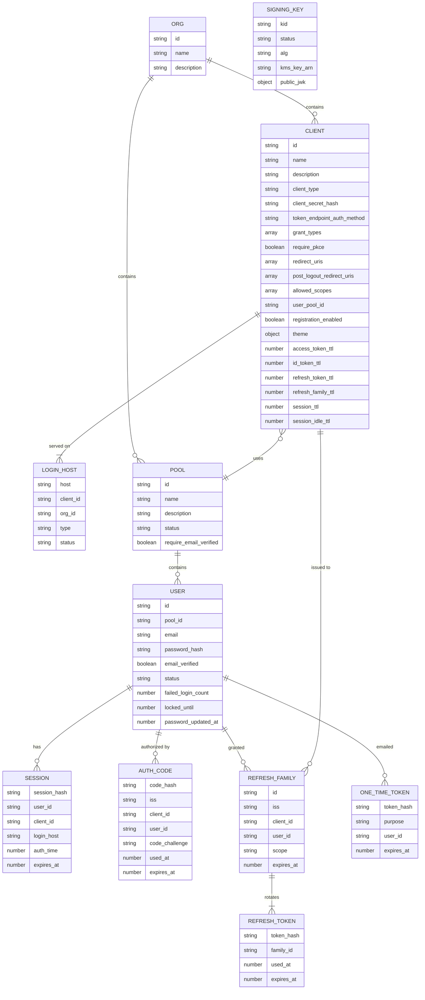

# Datamodel

This document describes the DynamoDB datamodel for LiteLogin. 

## Entities

`SIGNING_KEY` is global: one set of keys signs tokens for every org and host.

## Configuration Table

| PK | SK | Attributes |
| -- | -- | -- |
| ORG#{org} | DETAILS | name=LiteLogin, description, created_at, updated_at |
| ORG#{org} | CLIENT#{client} |  |
| ORG#{org} | POOL#{pool} |  |
| POOL#{pool} | DETAILS | org_id, name=Default, description="My User Pool Description", status=active\|deleting, require_email_verified=false, created_at, updated_at, version |
| USER#{user} | DETAILS | pool_id, email=example@example.com, password_hash="$argon2id$v=19$m=19456,t=2,p=1$...", email_verified=true, status=active\|disabled, failed_login_count, locked_until, password_updated_at, created_at, updated_at, version, GSI1PK=POOL#{pool}, GSI1SK=EMAIL#{email} |
| POOL#{pool}#EMAIL#{email} | EMAIL | user_id |
| CLIENT#{client} | DETAILS | org_id, name=LiteLogin, description, client_type=public\|confidential, client_secret_hash, token_endpoint_auth_method=none\|client_secret_basic\|client_secret_post, grant_types=[authorization_code, refresh_token], require_pkce=true, redirect_uris=[https://login.microsoftonline.com/common/oauth2/nativeclient], post_logout_redirect_uris=[], allowed_scopes=[openid, email, offline_access], user_pool_id={pool}, registration_enabled=true, theme={...}, access_token_ttl=900, id_token_ttl=900, refresh_token_ttl=2592000, refresh_family_ttl=7776000, session_ttl=604800, session_idle_ttl=86400, created_at, updated_at, version |
| CLIENT#{client} | LOGIN_HOST#{login_host} | type=default\|custom, status=pending\|verified |
| LOGIN_HOST#{login_host} | CLIENT | client_id, org_id, type=default\|custom, status=pending\|verified |
| KEYS | KID#{kid} | status=next\|active\|retired, alg=ES256, kms_key_arn, public_jwk, created_at, activated_at, retired_at |

- **Times:** all times are epoch seconds and all TTLs are in seconds.
- **Client secrets:** a client secret is a 256-bit random value, so it's stored as a SHA-256 hash (a slow password hash isn't needed) and compared in constant time. Public clients have no secret and `token_endpoint_auth_method=none`.
- **`version`:** used for optimistic locking. Every admin update increments it, with the condition `version = :expected`.
- **Login hosts:** a client's hosts are the `CLIENT#{client}` / `LOGIN_HOST#` items. The client item has no `login_hosts` attribute.
- **Signing keys:** private keys never leave KMS. Tokens are signed with the KMS `Sign` API, and the table holds only the public JWK and the rotation state.

User IDs are globally unique (UUIDv4 or ULID), so a user can be read by ID alone. Pool membership is the `pool_id` attribute, and email uniqueness is scoped to the pool by the `POOL#{pool}#EMAIL#{email}` item.

### GSI1 (pool → users)

| PK | SK | Projection |
| -- | -- | -- |
| GSI1PK = POOL#{pool} | GSI1SK = EMAIL#{email} | INCLUDE: email, email_verified, status, created_at |

The index is sparse: only user items carry GSI1 attributes. `password_hash` is never projected. GSI reads are eventually consistent, so this index is for admin listing and search only, never for login.

## Session Table

Holds short-lived authentication state: browser sessions, authorization codes, refresh tokens and one-time tokens.

- Every item has `expires_at` (epoch seconds), and DynamoDB TTL is enabled on that attribute. TTL deletion can lag by up to ~48 hours, so every read must also check `expires_at > now`.
- Every secret (session cookie, authorization code, refresh token, one-time token) is a 256-bit random value. Only its SHA-256 hash is stored, so a leaked table or backup can't be replayed. `{..._hash}` below means that hash, hex encoded.
- All reads from this table are strongly consistent.

| PK | SK | Attributes |
| -- | -- | -- |
| SESSION#{session_hash} | DETAILS | org_id, pool_id, user_id, client_id, login_host, auth_time, amr=["pwd"], created_at, last_seen_at, idle_expires_at, expires_at, ip, user_agent, GSI1PK=USER#{user}, GSI1SK=SESSION#{created_at} |
| CODE#{code_hash} | DETAILS | iss, client_id, redirect_uri, scope, nonce, code_challenge, code_challenge_method=S256, pool_id, user_id, session_hash, auth_time, used_at, family_id, expires_at (now + 60s) |
| REFRESH_FAMILY#{family} | DETAILS | iss, client_id, pool_id, user_id, scope, auth_time, created_at, expires_at (absolute lifetime), GSI1PK=USER#{user}, GSI1SK=REFRESH_FAMILY#{created_at} |
| REFRESH#{token_hash} | DETAILS | family_id, client_id, used_at, expires_at |
| OTT#{token_hash} | DETAILS | purpose=verify_email\|reset_password\|change_email, pool_id, user_id, email, new_email, expires_at |

- **Sessions:** `expires_at` is the absolute lifetime (and the TTL attribute). `idle_expires_at` is pushed forward on activity.
- **Refresh tokens:** every token belongs to a family that starts with one authorization code grant. A refresh token is valid only while its `REFRESH_FAMILY` item exists. To revoke a family, delete that item. Its orphaned `REFRESH` items then fail the check and expire through TTL.
- **Authorization codes:** kept after use (`used_at` set) until TTL removes them. A reused code can then be detected, and the family it issued revoked (RFC 6749 §4.1.2).

### GSI1 (user → sessions and refresh families)

| PK | SK | Projection |
| -- | -- | -- |
| GSI1PK = USER#{user} | GSI1SK = SESSION#{created_at} or REFRESH_FAMILY#{created_at} | INCLUDE: client_id, created_at, last_seen_at, ip, user_agent, expires_at |

The index is sparse. Only `SESSION` and `REFRESH_FAMILY` items carry GSI1 attributes, so codes, refresh tokens and one-time tokens aren't indexed.

## Access Patterns

The following describes the access patterns for both tables. Emails are always normalized (trimmed, lowercased) before they are used in a key, and hosts are normalized (lowercased, port and trailing dot removed, punycode).

### Resolve client from request

Used by every browser-facing endpoint (`/authorize`, login, registration, password reset, logout).

1. GetItem `LOGIN_HOST#{host}` / `CLIENT` → `client_id`, `org_id`, `status`. Reject unless `status=verified`.
2. If the request carries a `client_id` parameter, reject unless it equals the host's `client_id`.
3. GetItem `CLIENT#{client}` / `DETAILS` → `user_pool_id`, `redirect_uris`, `allowed_scopes`, `registration_enabled`, `theme`, token and session lifetimes.
4. If the request carries a `redirect_uri`, reject unless it exactly matches an entry in `redirect_uris`.
5. GetItem `POOL#{pool}` / `DETAILS` → `status`, `require_email_verified`. Reject unless `status=active`.

Steps 1, 3 and 5 read configuration that rarely changes, so they can be cached in the Lambda for 30–60 seconds.

### Discovery and JWKS

1. Resolve client from the request host (steps 1–2 only).
2. `/.well-known/openid-configuration`: return `issuer = https://{host}`, with every endpoint URL on that same host.
3. `/.well-known/jwks.json`: Query `PK=KEYS` and return the `public_jwk` of every item (`next`, `active` and `retired`), so tokens signed by any of them still validate. It's the same on every host and can be cached for 5 minutes.

### Register with email and password

1. Resolve client. Reject if `registration_enabled` is false.
2. Generate a new user ID (UUIDv4 or ULID) and hash the password (argon2id).
3. TransactWriteItems:
   - Put `USER#{user}` / `DETAILS` (`pool_id`, `GSI1PK=POOL#{pool}`, `GSI1SK=EMAIL#{email}`, `email`, `password_hash`, `email_verified=false`, `status=active`, `created_at`), condition `attribute_not_exists(PK)`
   - Put `POOL#{pool}#EMAIL#{email}` / `EMAIL` (`user_id`), condition `attribute_not_exists(PK)`
4. If the transaction is cancelled because of the email item, the email is already registered. To avoid revealing that, show the same "check your email" page and send the existing user an email instead.
5. Put `OTT#{token_hash}` / `DETAILS` (`purpose=verify_email`, `pool_id`, `user_id`, `email`, `expires_at` = now + 24h) and send the verification email.

### Login with email and password

1. Resolve client → `user_pool_id`.
2. GetItem `POOL#{pool}#EMAIL#{email}` / `EMAIL` (strongly consistent) → `user_id`. If not found, verify the password against a dummy hash anyway (so response time doesn't reveal which emails exist), then fail.
3. GetItem `USER#{user}` / `DETAILS` → `password_hash`, `status`, `email_verified`.
4. Reject if `locked_until > now`. Verify the password. Reject unless `status=active`, and unless `email_verified` is true when the pool's `require_email_verified` is true. Use the same error message for every failure.
   - Wrong password: UpdateItem ADD `failed_login_count 1`. If the new count reaches the limit (e.g. 5), SET `locked_until = now + 15 min` and reset the count.
   - Correct password with a non-zero count: UpdateItem SET `failed_login_count = 0`.
5. If the hash uses outdated parameters, rehash and UpdateItem `password_hash`.
6. Put `SESSION#{session_hash}` / `DETAILS` with `auth_time=now` and GSI1 keys. Set the session cookie (`HttpOnly`, `Secure`, `SameSite=Lax`).
7. Continue the pending `/authorize` request.

### Authorize (`/authorize`)

1. Resolve client. Validate `response_type=code`, `scope` ⊆ `allowed_scopes`, and that `code_challenge` (S256) is present when the client requires PKCE.
2. If there is a session cookie, GetItem `SESSION#{session_hash}` / `DETAILS`. The session is usable only if:
   - `expires_at` and `idle_expires_at` are in the future
   - its `pool_id` equals the client's `user_pool_id`
   - `max_age` (if requested) is satisfied by `auth_time`
   - `prompt=login` was not requested
3. If there is no usable session: return `login_required` for `prompt=none`, otherwise show the login page.
4. UpdateItem the session's `last_seen_at` and `idle_expires_at`. To limit writes, only do this if `last_seen_at` is more than 5 minutes old.
5. Put `CODE#{code_hash}` / `DETAILS` (`iss` = `https://{host}` of this request, `expires_at` = now + 60s), condition `attribute_not_exists(PK)`.
6. Redirect to `redirect_uri` with `code` and `state`.

### Exchange authorization code (`/token`, `grant_type=authorization_code`)

1. GetItem `CLIENT#{client}` / `DETAILS`. Authenticate the client: confidential clients verify `client_secret` against `client_secret_hash`. Public clients send only `client_id` and rely on PKCE.
2. UpdateItem `CODE#{code_hash}` / `DETAILS` SET `used_at = :now`, condition `attribute_exists(PK) AND attribute_not_exists(used_at) AND expires_at > :now`, ReturnValues `ALL_NEW`. This makes each code single use.
   - If the condition fails, GetItem the code. If it exists and has `used_at` and `family_id`, the code is being reused: DeleteItem `REFRESH_FAMILY#{family_id}`. Return `invalid_grant` in either case.
3. Verify `client_id` and `redirect_uri` match the code, that `code_verifier` matches `code_challenge`, and that this request's host matches the code's `iss`.
4. GetItem `USER#{user}` / `DETAILS`. Reject unless `status=active`.
5. If the client is allowed refresh tokens, TransactWriteItems:
   - Put `REFRESH_FAMILY#{family}` / `DETAILS` (`iss` copied from the code, with GSI1 keys)
   - Put `REFRESH#{token_hash}` / `DETAILS`
   - Update `CODE#{code_hash}` SET `family_id`
6. Sign the ID token and access token with the code's `iss`, using KMS `Sign` with the `active` signing key (its `kid` goes in the JWT header). The Lambda caches which key is active for 5 minutes. Return them along with the refresh token.

### Refresh tokens (`/token`, `grant_type=refresh_token`)

1. Authenticate the client (as above).
2. GetItem `REFRESH#{token_hash}` / `DETAILS`. Return `invalid_grant` if it's missing, expired, or issued to a different `client_id`.
3. If `used_at` is set, the token is being reused. DeleteItem `REFRESH_FAMILY#{family_id}` and return `invalid_grant`.
4. GetItem `REFRESH_FAMILY#{family_id}` / `DETAILS` → `user_id`, `scope`, `iss`. Return `invalid_grant` if it's missing (revoked) or if this request's host doesn't match `iss`.
5. TransactWriteItems:
   - ConditionCheck `REFRESH_FAMILY#{family_id}`: `attribute_exists(PK)`
   - Update `REFRESH#{old_hash}` SET `used_at`, condition `attribute_not_exists(used_at)`
   - Put `REFRESH#{new_hash}` (same `family_id`, `expires_at` = min(now + token lifetime, family `expires_at`))
6. If the transaction fails, return `invalid_grant`.
7. GetItem `USER#{user}` / `DETAILS`. Reject unless `status=active`. Issue new tokens with the family's `iss`.

### UserInfo (`/userinfo`)

1. Verify the access token's signature and expiry, and that its `iss` matches this request's host. No table read is needed for this.
2. GetItem `USER#{sub}` / `DETAILS` and return claims for the granted scopes.

Access tokens are not revocable before they expire, so keep their lifetime short (5–15 minutes).

### Logout (`/logout`)

1. Resolve client. If `id_token_hint` is present, verify its signature (expired tokens are accepted) and take the `client_id` from it.
2. Reject `post_logout_redirect_uri` unless it exactly matches an entry in the client's `post_logout_redirect_uris`.
3. DeleteItem `SESSION#{session_hash}` / `DETAILS` and clear the cookie.

Refresh token families are not tied to the browser session and survive logout. Use the next pattern to revoke them.

### Revoke everything for a user (logout everywhere)

Also used after a password reset, a password change, or disabling the user.

1. Query GSI1 `GSI1PK = USER#{user}`. This returns every session and refresh family.
2. BatchWriteItem: delete each returned `SESSION` and `REFRESH_FAMILY` item. Paginate if needed.

### List a user's active sessions

1. Query GSI1 `GSI1PK = USER#{user}`, `begins_with(GSI1SK, "SESSION#")`. Skip any result whose `expires_at` has passed.

### Verify email

1. TransactWriteItems:
   - Delete `OTT#{token_hash}` / `DETAILS`, condition `purpose = verify_email AND expires_at > :now`
   - Update `USER#{user}` / `DETAILS` SET `email_verified = true`, condition `email = :ott_email`. This guards against the email having changed since the token was sent.
2. If the transaction fails, show "link invalid or expired."

### Request password reset

1. Resolve client → `user_pool_id`.
2. GetItem `POOL#{pool}#EMAIL#{email}` / `EMAIL`. If the user exists, Put `OTT#{token_hash}` / `DETAILS` (`purpose=reset_password`, `expires_at` = now + 30 min) and send the email.
3. Always show the same "if an account exists, we sent an email" response.

### Complete password reset

1. Hash the new password.
2. TransactWriteItems:
   - Delete `OTT#{token_hash}` / `DETAILS`, condition `purpose = reset_password AND expires_at > :now`
   - Update `USER#{user}` / `DETAILS` SET `password_hash`, `password_updated_at`, `email_verified = true` (the user just proved they own the email)
3. Revoke everything for the user.

### Change password (signed in)

1. Verify the current password (as in login steps 3–4).
2. UpdateItem `USER#{user}` / `DETAILS` SET `password_hash`, `password_updated_at`.
3. Revoke everything for the user, then create a new session for the current browser.

### Change email (signed in)

1. Put `OTT#{token_hash}` / `DETAILS` (`purpose=change_email`, `user_id`, `email` = current, `new_email`, `expires_at` = now + 24h). Send the link to `new_email`.
2. On confirmation, TransactWriteItems:
   - Delete `OTT#{token_hash}`, condition `purpose = change_email AND expires_at > :now`
   - Put `POOL#{pool}#EMAIL#{new_email}` / `EMAIL`, condition `attribute_not_exists(PK)`
   - Delete `POOL#{pool}#EMAIL#{old_email}` / `EMAIL`, condition `user_id = :user`
   - Update `USER#{user}` / `DETAILS` SET `email = :new`, `GSI1SK = EMAIL#{new_email}`, `email_verified = true`, condition `email = :old`
3. If the transaction fails on the new email item, show "email already in use."

### Admin: organization, clients and pools

| Pattern | Operation |
| -- | -- |
| Get org | GetItem `ORG#{org}` / `DETAILS` |
| List clients in org | Query `PK=ORG#{org}`, `begins_with(SK, "CLIENT#")`, then BatchGetItem `CLIENT#{client}` / `DETAILS` |
| List pools in org | Query `PK=ORG#{org}`, `begins_with(SK, "POOL#")`, then BatchGetItem `POOL#{pool}` / `DETAILS` |
| Create pool | TransactWriteItems: Put `POOL#{pool}` / `DETAILS` + Put `ORG#{org}` / `POOL#{pool}` |
| Create client | TransactWriteItems: Put `CLIENT#{client}` / `DETAILS`, Put `ORG#{org}` / `CLIENT#{client}`, Put the default login host (both items, below) |
| Update client | UpdateItem `CLIENT#{client}` / `DETAILS`, condition `version = :expected` |
| Delete client | Query `PK=CLIENT#{client}`, `begins_with(SK, "LOGIN_HOST#")`; TransactWriteItems deleting the client item, the org index item, and both items for each host |
| List users in pool | Query config GSI1 `GSI1PK=POOL#{pool}` (sorted by email, paginated) |
| Search users by email prefix | Query config GSI1 `GSI1PK=POOL#{pool}`, `begins_with(GSI1SK, "EMAIL#{prefix}")` |
| Get user | GetItem `USER#{user}` / `DETAILS` |
| Disable user | UpdateItem `USER#{user}` / `DETAILS` SET `status=disabled`, then revoke everything for the user |
| Delete user | Revoke everything for the user, then TransactWriteItems deleting `USER#{user}` / `DETAILS` and `POOL#{pool}#EMAIL#{email}` / `EMAIL` |
| Delete pool | Reject if any client in the org uses it (Query the org's clients, BatchGetItem, check `user_pool_id`). Otherwise UpdateItem `POOL#{pool}` SET `status=deleting`, then a background job pages through config GSI1 `GSI1PK=POOL#{pool}` deleting each user (as above), and finally deletes `POOL#{pool}` / `DETAILS` and `ORG#{org}` / `POOL#{pool}` |

### Admin: login hosts

| Pattern | Operation |
| -- | -- |
| List a client's hosts | Query `PK=CLIENT#{client}`, `begins_with(SK, "LOGIN_HOST#")` |
| Add host | TransactWriteItems: Put `LOGIN_HOST#{host}` / `CLIENT` (`client_id`, `org_id`, `type`, `status=pending`), condition `attribute_not_exists(PK)`; Put `CLIENT#{client}` / `LOGIN_HOST#{host}` (`type`, `status=pending`). The default host is created with `status=verified`. |
| Verify custom host | After the DNS TXT or ACM check passes, TransactWriteItems updating `status=verified` on both items |
| Remove host | TransactWriteItems deleting both items |

### Rotate signing keys

Runs on a schedule (e.g. every 90 days).

1. **Prepare.** Create an asymmetric KMS key (`ECC_NIST_P256`, `SIGN_VERIFY`) and call `GetPublicKey`. Put `KEYS` / `KID#{kid}` (`status=next`, `public_jwk`, `kms_key_arn`), condition `attribute_not_exists(PK)`. The key now appears in the JWKS, but nothing is signed with it yet.
2. **Activate.** Wait at least as long as relying parties cache the JWKS (24 hours is safe), so they already trust the key. Then TransactWriteItems:
   - Update the current key SET `status=retired`, `retired_at`, condition `status = active`
   - Update the next key SET `status=active`, `activated_at`, condition `status = next`
3. **Remove.** Once a retired key is older than the longest ID or access token lifetime plus the JWKS cache time, DeleteItem its `KEYS` item and schedule its KMS key for deletion.

Refresh tokens are opaque and not signed, so rotation doesn't affect them.

KMS `Sign` requests count against a per-account, per-region quota. Request a quota increase before load testing.

## Decisions

1. **Admins can list users in a pool.** This is served by config GSI1 (pool → users).
2. **User IDs are globally unique.** User items are keyed `USER#{user}`, and the token `sub` is the user ID, so no pool claim is needed.
3. **`iss` is the URL of the host used for login.** Discovery on each host advertises that host as its issuer. The issuer is fixed when the authorization code is created and carried on the code and the refresh family, so refreshed tokens keep it. Token, refresh and userinfo requests must arrive on that same host.
   - Consequence: relying parties identify users by `iss` + `sub`. If a client moves from its default host to a custom host, the RP sees a new issuer and must be reconfigured, and RPs that key users on `iss` + `sub` will treat existing users as new ones. Document this for customers adding a custom domain.
4. **Signing keys live in KMS.** One global key set (ES256) signs tokens for every org and host. DynamoDB holds only the public keys and the rotation state.

