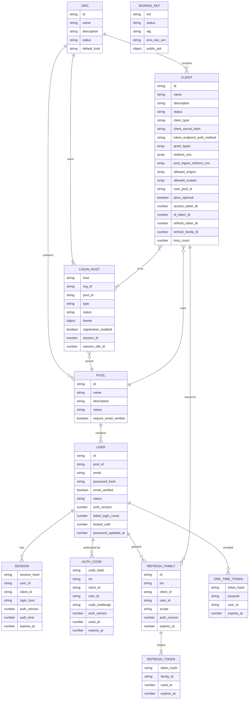

# Datamodel

This document describes the DynamoDB datamodel for LiteLogin. 

## Entities

`SIGNING_KEY` is global: one set of keys signs tokens for every org and host.

## Configuration Table

| PK | SK | Attributes |
| -- | -- | -- |
| ORG#{org} | DETAILS | name=LiteLogin, description, status=active\|suspended, default_host={label}.litelogin.com, created_at, updated_at, version |
| ORGS | ORG#{created_at}#{org} | org_id |
| ORG#{org} | CLIENT#{client} |  |
| ORG#{org} | POOL#{pool} |  |
| ORG#{org} | LOGIN_HOST#{login_host} |  |
| POOL#{pool} | DETAILS | org_id, name=Default, description="My User Pool Description", status=active\|deleting, require_email_verified=false, created_at, updated_at, version, (while deleting) GSI2PK=WORK, GSI2SK=pool_deletion#{pool}, work_attempts, work_updated_at |
| USER#{user} | DETAILS | pool_id, email=example@example.com, password_hash="$argon2id$v=19$m=19456,t=2,p=1$...", email_verified=true, status=active\|disabled, auth_version=1, failed_login_count, locked_until, password_updated_at, created_at, updated_at, version, GSI1PK=POOL#{pool}, GSI1SK=EMAIL#{email} |
| POOL#{pool}#EMAIL#{email} | EMAIL | user_id |
| CLIENT#{client} | DETAILS | org_id, name=LiteLogin, description, status=active\|disabled, client_type=public\|confidential, client_secret_hash, token_endpoint_auth_method=none\|client_secret_basic\|client_secret_post, grant_types=[authorization_code, refresh_token], redirect_uris=[https://login.microsoftonline.com/common/oauth2/nativeclient], post_logout_redirect_uris=[], allowed_origins=[https://app.acme.com], allowed_scopes=[openid, email, offline_access], user_pool_id={pool} (the pool of the host it was created on; fixed), pkce_optional (absent = PKCE required; only on confidential clients), access_token_ttl=900, id_token_ttl=900, refresh_token_ttl=2592000, refresh_family_ttl=7776000, host_count=1, created_at, updated_at, version |
| LOGIN_HOST#{login_host} | DETAILS | org_id, pool_id, type=default\|custom, status=pending\|verified\|removing, theme={...}, registration_enabled=true, session_ttl=604800, session_idle_ttl=86400, created_at, updated_at, version, (while pending or removing) GSI2PK=WORK, GSI2SK=custom_domain#{login_host}, work_attempts, work_updated_at, work_last_error |
| LOGIN_HOST#{login_host} | CLIENT#{client} | client_id |
| CLIENT#{client} | LOGIN_HOST#{login_host} |  |
| KEYS | KID#{kid} | status=next\|active\|retired, alg=RS256, kms_key_arn, public_jwk, created_at, activated_at, retired_at |

- **Times:** all times are epoch seconds and all TTLs are in seconds.
- **Client secrets:** a client secret is a 256-bit random value, so it's stored as a SHA-256 hash (a slow password hash isn't needed) and compared in constant time. Public clients have no secret and `token_endpoint_auth_method=none`.
- **`version`:** used for optimistic locking. Every admin update increments it, with the condition `version = :expected`.
- **Login hosts:** a host belongs to an org and serves one of its pools. Every org has a default host, `{label}.litelogin.com`, created with the org (with the org's default pool) and never removed; further hosts are custom domains. A custom host is `verified` only when both its certificate has been issued and its DNS (CNAME) points to LiteLogin. Only `verified` hosts serve requests.
- **Host settings:** the theme, `registration_enabled` and session lifetimes are the host's, and apply to every client on it: a host's pages and sessions are shared by its clients.
- **Memberships:** a client is on a host when `LOGIN_HOST#{host}` / `CLIENT#{client}` exists (with the reverse item `CLIENT#{client}` / `LOGIN_HOST#{host}` for listing a client's hosts). Only clients of the host's org and pool can join it. A client is created on one host and is always on at least one: `host_count` counts its memberships, and removing the last one is refused.
- **`allowed_origins`:** the browser origins allowed to call `/token` and `/userinfo` cross-origin (CORS). It is configured separately from `redirect_uris`, and is empty for clients that never call these endpoints from a browser.
- **Signing keys:** private keys never leave KMS. Tokens are signed with the KMS `Sign` API (`RSASSA_PKCS1_V1_5_SHA_256`), and the table holds only the public JWK and the rotation state. KMS returns RSA signatures as raw bytes, which go straight into the JWT. If ES256 is ever added, note that KMS returns ECDSA signatures DER-encoded; they must be converted to the 64-byte `R || S` form that JWTs require.
- **PKCE:** required by default, and always for public clients. Only `code_challenge_method=S256` is accepted. A confidential client can opt out (`pkce_optional`, Decision 6).
- **`auth_version`:** a counter on the user, starting at 1. Sessions, authorization codes and refresh families record the value at the time they were created, and are valid only while it still equals the user's current value. See "Revoke everything for a user".

User IDs are globally unique (UUIDv4 or ULID), so a user can be read by ID alone. Pool membership is the `pool_id` attribute, and email uniqueness is scoped to the pool by the `POOL#{pool}#EMAIL#{email}` item.

### GSI1 (pool → users)

| PK | SK | Projection |
| -- | -- | -- |
| GSI1PK = POOL#{pool} | GSI1SK = EMAIL#{email} | INCLUDE: email, email_verified, status, created_at |

The index is sparse: only user items carry GSI1 attributes. `password_hash` is never projected. GSI reads are eventually consistent, so this index is for admin listing and search only, never for login.

### GSI2 (outstanding background work)

| PK | SK | Projection |
| -- | -- | -- |
| GSI2PK = WORK | GSI2SK = {work_type}#{id} | INCLUDE: status, work_attempts, work_updated_at, work_last_error |

- **What it holds:** an item carries GSI2 attributes only while it has background work outstanding: a login host that is `pending` or `removing`, or a pool that is `deleting`. The Worker removes them when the work is done, so the index only ever holds in-progress work.
- **How it's used:** the DynamoDB stream starts work immediately. The scheduled reconciler queries GSI2 to retry work whose `work_updated_at` is stale, so a missed stream record or a failed Worker run can't leave work stuck.
- **Partition size:** this index uses a single partition key, which is fine because the volume of outstanding work is small.

## Session Table

Holds short-lived authentication state: browser sessions, authorization codes, refresh tokens and one-time tokens.

- Every item has `expires_at` (epoch seconds), and DynamoDB TTL is enabled on that attribute. TTL deletion can lag by up to ~48 hours, so every read must also check `expires_at > now`.
- Every secret (session cookie, authorization code, refresh token, one-time token) is a 256-bit random value. Only its SHA-256 hash is stored, so a leaked table or backup can't be replayed. `{..._hash}` below means that hash, hex encoded.
- All base-table reads are strongly consistent. GSI1 reads can't be (DynamoDB only offers eventually consistent reads on a GSI), so GSI1 is never used to decide whether a credential is valid. That decision always comes from base-table reads and `auth_version`.
- **Transaction conflicts.** When two transactions touch the same item at once, DynamoDB may cancel one with `TransactionConflict` instead of evaluating its conditions. Such transactions are retried with backoff. Once the other transaction commits, the retry fails on its condition (or succeeds), so the loser of a race always ends with a condition failure and the reuse checks below behave the same.

| PK | SK | Attributes |
| -- | -- | -- |
| SESSION#{session_hash} | DETAILS | org_id, pool_id, user_id, client_id, login_host, auth_version, auth_time, amr=["pwd"], created_at, last_seen_at, idle_expires_at, expires_at, ip, user_agent, GSI1PK=USER#{user}, GSI1SK=SESSION#{created_at} |
| CODE#{code_hash} | DETAILS | iss, client_id, redirect_uri, scope, nonce, code_challenge, code_challenge_method=S256, pool_id, user_id, session_hash, auth_version, auth_time, used_at, family_id, expires_at (now + 60s) |
| REFRESH_FAMILY#{family} | DETAILS | iss, client_id, pool_id, user_id, scope, auth_version, auth_time, created_at, expires_at (absolute lifetime), GSI1PK=USER#{user}, GSI1SK=REFRESH_FAMILY#{created_at} |
| REFRESH#{token_hash} | DETAILS | family_id, client_id, used_at, expires_at |
| OTT#{token_hash} | DETAILS | purpose=verify_email\|reset_password\|change_email, pool_id, user_id, email, new_email, expires_at |
| IDEMPOTENCY#{caller_hash}#{key} | DETAILS | request_hash, status=in_progress\|completed, response_status, response_body, expires_at (now + 24h) |

- **Idempotency keys:** `IDEMPOTENCY` items record admin API requests sent with an `Idempotency-Key` header. `{caller_hash}` is a SHA-256 of the caller's IAM principal ARN, so keys are scoped per caller.
- **Secrets are never stored in the response.** `response_body` omits client secrets, so a replayed "create client" response has no secret and includes `"secret_unavailable": true`. A caller that lost the original response rotates the secret.

- **Sessions:** `expires_at` is the absolute lifetime (and the TTL attribute). `idle_expires_at` is pushed forward on activity.
- **Refresh tokens:** every token belongs to a family that starts with one authorization code grant. A refresh token is valid only while its `REFRESH_FAMILY` item exists. To revoke a family, delete that item. Its orphaned `REFRESH` items then fail the check and expire through TTL.
- **Authorization codes:** kept after use (`used_at` set) until TTL removes them. A reused code can then be detected, and the family it issued revoked (RFC 6749 §4.1.2).
- **Revocation:** a session, code or refresh family is valid only while its `auth_version` equals the user's current `auth_version`. Incrementing the user's `auth_version` revokes all of them at once. Deleting the items afterwards is only cleanup.

### GSI1 (user → sessions and refresh families)

| PK | SK | Projection |
| -- | -- | -- |
| GSI1PK = USER#{user} | GSI1SK = SESSION#{created_at} or REFRESH_FAMILY#{created_at} | INCLUDE: client_id, auth_version, created_at, last_seen_at, ip, user_agent, expires_at |

The index is sparse. Only `SESSION` and `REFRESH_FAMILY` items carry GSI1 attributes, so codes, refresh tokens and one-time tokens aren't indexed. It is used for listing and cleanup only, never for validation.

## Access Patterns

The following describes the access patterns for both tables. Emails are always normalized (trimmed, lowercased) before they are used in a key, and hosts are normalized (lowercased, port and trailing dot removed, punycode).

### Resolve login host from request

Used by every endpoint on a login host.

1. GetItem `LOGIN_HOST#{host}` / `DETAILS` → `org_id`, `pool_id`, `status` and the host settings. Reject unless `status=verified`.
2. GetItem `ORG#{org}` / `DETAILS` → `status`. Reject unless `status=active`.
3. GetItem `POOL#{pool}` / `DETAILS` → `status`, `require_email_verified`. Reject unless `status=active`.

### Resolve client on a host

Once a request names its client (`client_id` at `/authorize` and `/logout`, the authenticated client at `/token`, the token's `client_id` at `/userinfo`):

1. GetItem `LOGIN_HOST#{host}` / `CLIENT#{client}`. Reject unless it exists: the client isn't on this host.
2. GetItem `CLIENT#{client}` / `DETAILS` → `status`, `user_pool_id`, `redirect_uris`, `allowed_scopes`, token lifetimes. Reject unless `status=active` and `user_pool_id` is the host's pool.
3. If the request carries a `redirect_uri`, reject unless it exactly matches an entry in `redirect_uris`.

Every read in both patterns is of configuration that rarely changes, so they're cached in the Lambda for 30–60 seconds. As a result, suspending an org, disabling a client or taking it off a host takes effect within that cache time.

### Discovery and JWKS

1. Resolve the login host from the request.
2. `/.well-known/openid-configuration`: return `issuer = https://{host}`, with every endpoint URL on that same host.
3. `/.well-known/jwks.json`: Query `PK=KEYS` and return the `public_jwk` of every item (`next`, `active` and `retired`), so tokens signed by any of them still validate. It's the same on every host and can be cached for 5 minutes.

### Register with email and password

1. Resolve the login host. Reject if its `registration_enabled` is false.
2. Generate a new user ID (UUIDv4 or ULID) and hash the password (argon2id).
3. TransactWriteItems:
   - Put `USER#{user}` / `DETAILS` (`pool_id`, `GSI1PK=POOL#{pool}`, `GSI1SK=EMAIL#{email}`, `email`, `password_hash`, `email_verified=false`, `status=active`, `auth_version=1`, `created_at`), condition `attribute_not_exists(PK)`
   - Put `POOL#{pool}#EMAIL#{email}` / `EMAIL` (`user_id`), condition `attribute_not_exists(PK)`
   - ConditionCheck `POOL#{pool}` / `DETAILS`: `status = active`. This stops a user being created behind a pool deletion that's already running.
4. If the transaction is cancelled because of the email item, the email is already registered. To avoid revealing that, show the same "check your email" page:
   - If the existing user's `email_verified` is false, send a new verification email (step 5). This covers a user retrying after their first registration request failed while sending email.
   - Otherwise, send the existing user a "you already have an account" email with a password reset link.
5. Put `OTT#{token_hash}` / `DETAILS` (`purpose=verify_email`, `pool_id`, `user_id`, `email`, `expires_at` = now + 24h) and send the verification email.

### Login with email and password

1. Resolve the login host → `pool_id`.
2. GetItem `POOL#{pool}#EMAIL#{email}` / `EMAIL` (strongly consistent) → `user_id`. If not found, verify the password against a dummy hash anyway (so response time doesn't reveal which emails exist), then fail.
3. GetItem `USER#{user}` / `DETAILS` (strongly consistent) → `password_hash`, `status`, `email_verified`, `locked_until`, `auth_version`.
4. Reject if `locked_until > now`. Verify the password. Reject unless `status=active`, and unless `email_verified` is true when the pool's `require_email_verified` is true. Use the same error message for every failure.
   - Wrong password: UpdateItem ADD `failed_login_count 1`. If the new count reaches the limit (e.g. 5), SET `locked_until = now + 15 min` and reset the count.
   - Correct password with a non-zero count: UpdateItem SET `failed_login_count = 0`.
5. If the hash uses outdated parameters, rehash and UpdateItem `password_hash`, condition `password_hash = :old`, so a concurrent password change is never overwritten.
6. Put `SESSION#{session_hash}` / `DETAILS` with `auth_time=now`, the user's current `auth_version`, `login_host`, the `client_id` of the sign-in request (if any, for the user's session list), GSI1 keys, and the host's session lifetimes. Set the session cookie (`HttpOnly`, `Secure`, `SameSite=Lax`, host-only).
7. Continue the pending `/authorize` request.

### Authorize (`/authorize`)

1. Resolve the login host, then the client (`client_id`) on it. Validate `response_type=code` and `scope` ⊆ `allowed_scopes`. Reject unless `code_challenge` is present with `code_challenge_method=S256`. The one exception: a confidential client with `pkce_optional` may omit PKCE entirely. `plain` is always rejected, and PKCE that is sent is always checked.
2. If there is a session cookie, GetItem `SESSION#{session_hash}` / `DETAILS`, then GetItem `USER#{user}` / `DETAILS` (strongly consistent) → `status`, `auth_version`. The session is usable only if:
   - `expires_at` and `idle_expires_at` are in the future
   - its `login_host` is this host and its `pool_id` the host's pool (whichever client on the host started it)
   - the user exists and has `status=active`
   - the session's `auth_version` equals the user's `auth_version`
   - `max_age` (if requested) is satisfied by `auth_time`
   - `prompt=login` was not requested
3. If there is no usable session: return `login_required` for `prompt=none`, otherwise show the login page.
4. UpdateItem the session's `last_seen_at` and `idle_expires_at`. To limit writes, only do this if `last_seen_at` is more than 5 minutes old.
5. Put `CODE#{code_hash}` / `DETAILS` (`iss` = `https://{host}` of this request, the session's `auth_version`, `expires_at` = now + 60s), condition `attribute_not_exists(PK)`.
6. Redirect to `redirect_uri` with `code` and `state`.

### Exchange authorization code (`/token`, `grant_type=authorization_code`)

Everything is validated before the code is consumed, so a wrong `code_verifier` can't burn a valid code. Consuming the code and creating the refresh family happen in one transaction.

1. Resolve the login host, then the client on it (cached). Authenticate the client: confidential clients verify `client_secret` against `client_secret_hash`. Public clients send only `client_id` and rely on PKCE.
2. GetItem `CODE#{code_hash}` / `DETAILS`. Return `invalid_grant` if it's missing or expired.
   - If `used_at` is already set, the code is being reused. If it has a `family_id`, DeleteItem `REFRESH_FAMILY#{family_id}`. Return `invalid_grant`.
3. Verify all of the following, and return `invalid_grant` without consuming the code if any fails:
   - `client_id` and `redirect_uri` match the code
   - SHA-256 of `code_verifier` matches `code_challenge`. A code issued without a challenge rejects any `code_verifier`, so a code from a request without PKCE can't pass as a protected one (RFC 9700 §2.1.1).
   - a code issued without a challenge is redeemed only by a client that still has `pkce_optional` (and so is confidential and authenticated), and only by a request without an `Origin` header: browsers always send PKCE (Decision 6).
   - this request's host matches the code's `iss`
4. GetItem `USER#{user}` / `DETAILS` → `status`, `auth_version`. Return `invalid_grant` unless `status=active` and the user's `auth_version` equals the code's.
5. TransactWriteItems:
   - Update `CODE#{code_hash}` SET `used_at = :now` (and `family_id`, if a refresh token is being issued), condition `attribute_not_exists(used_at) AND expires_at > :now`
   - ConditionCheck `USER#{user}`: `status = active AND auth_version = :code_auth_version`
   - If the client is allowed refresh tokens: Put `REFRESH_FAMILY#{family}` / `DETAILS` (`iss` and `auth_version` copied from the code, with GSI1 keys), condition `attribute_not_exists(PK)`
   - If the client is allowed refresh tokens: Put `REFRESH#{token_hash}` / `DETAILS`, condition `attribute_not_exists(PK)`
6. If the transaction fails, GetItem the code again. If `used_at` is now set, a concurrent request redeemed it first: treat this as reuse and DeleteItem `REFRESH_FAMILY#{family_id}`. Return `invalid_grant` in every failure case.
7. Sign the ID token and access token with the code's `iss`, using KMS `Sign` with the `active` signing key (its `kid` goes in the JWT header). The Lambda caches which key is active for 5 minutes. Return them along with the refresh token.

If the Lambda crashes after step 5 commits, the code is consumed and the client must restart authorization. That's the intended trade-off for single-use codes.

### Refresh tokens (`/token`, `grant_type=refresh_token`)

1. Authenticate the client (as above, including the client and org status checks).
2. GetItem `REFRESH#{token_hash}` / `DETAILS`. Return `invalid_grant` if it's missing, expired, or issued to a different `client_id`.
3. If `used_at` is set, the token is being reused. DeleteItem `REFRESH_FAMILY#{family_id}` and return `invalid_grant`.
4. GetItem `REFRESH_FAMILY#{family_id}` / `DETAILS` → `user_id`, `scope`, `iss`, `auth_version`. Return `invalid_grant` if it's missing (revoked) or if this request's host doesn't match `iss`.
5. GetItem `USER#{user}` / `DETAILS` → `status`, `auth_version`. Return `invalid_grant` unless `status=active` and the user's `auth_version` equals the family's.
6. TransactWriteItems:
   - ConditionCheck `REFRESH_FAMILY#{family_id}`: `attribute_exists(PK)`
   - ConditionCheck `USER#{user}`: `status = active AND auth_version = :family_auth_version`. This stops a concurrent disable or password reset from racing with token issuance.
   - Update `REFRESH#{old_hash}` SET `used_at`, condition `attribute_not_exists(used_at)`
   - Put `REFRESH#{new_hash}` (same `family_id`, `expires_at` = min(now + token lifetime, family `expires_at`)), condition `attribute_not_exists(PK)`
7. If the transaction fails, GetItem `REFRESH#{old_hash}` again. If `used_at` is now set, a concurrent request used the same token: treat it as reuse and DeleteItem `REFRESH_FAMILY#{family_id}`. Return `invalid_grant` in every failure case.
8. Issue new tokens with the family's `iss`.

Reuse detection is strict: two simultaneous requests with the same token revoke the family, even when they're a legitimate client retry. If that causes support problems (typically mobile apps on unreliable networks), add a grace window of a few seconds. Within that window, a just-used token returns `invalid_grant` without revoking the family.

### UserInfo (`/userinfo`)

1. Verify the access token's signature and expiry, and that its `iss` matches this request's host. Resolve the token's `client_id` on the host (cached): a client taken off the host can't use its tokens there.
2. GetItem `USER#{sub}` / `DETAILS`. Return `401` unless the user exists and has `status=active`. Otherwise return claims for the granted scopes.

Access tokens are not revocable before they expire, so keep their lifetime short (5–15 minutes).

### Logout (`/logout`)

1. Resolve the login host. The client is named by `client_id` or by the audience of `id_token_hint` (signature verified; expired tokens are accepted). If both are given they must agree, and the client must be on the host.
2. Reject `post_logout_redirect_uri` unless a client is named and the URI exactly matches an entry in its `post_logout_redirect_uris`.
3. DeleteItem `SESSION#{session_hash}` / `DETAILS` and clear the cookie. The session is the host's, so this signs the user out of every client on the host.

Refresh token families are not tied to the browser session and survive logout. Use the next pattern to revoke them.

### CORS on `/token` and `/userinfo`

A preflight request carries neither credentials nor a `client_id`, so it's allowed for the `allowed_origins` of every active client on the host (Query `PK=LOGIN_HOST#{host}`, `begins_with(SK, "CLIENT#")`, cached). The response to the request itself allows only its own client's origins, once the client is known.

### Revoke everything for a user (logout everywhere)

Also used after a password reset, a password change, or disabling the user. In those flows, step 1 is part of that flow's own user update.

1. **Revoke.** UpdateItem `USER#{user}` / `DETAILS` ADD `auth_version 1`. From this moment, every existing session, unredeemed code and refresh family for the user fails validation. This step is the revocation.
2. **Clean up.** The Worker does this asynchronously, started by the Config table stream: a user item whose `auth_version` increased, or that was deleted.
   - Query GSI1 `GSI1PK = USER#{user}`, following `LastEvaluatedKey`.
   - Delete every `SESSION` and `REFRESH_FAMILY` item whose `auth_version` is lower than the user's current value (every one, if the user no longer exists). BatchWriteItem takes at most 25 deletes per call; retry `UnprocessedItems` with backoff.
   - The Worker deletes in batches of 500. A batch ends with a cursor (the GSI1 key of its last item); if the invocation runs short of time, the rest of the job goes to the SQS continuation queue with that cursor.
   - GSI1 may not yet show items created moments before step 1. That's harmless: step 1 already invalidated them, and TTL removes them.

Access tokens that were already issued stay valid until they expire, which is why their lifetime is kept short.

### List a user's active sessions

1. GetItem `USER#{user}` / `DETAILS` → `auth_version`.
2. Query GSI1 `GSI1PK = USER#{user}`, `begins_with(GSI1SK, "SESSION#")`. Skip any result whose `expires_at` has passed or whose `auth_version` is lower than the user's.

The account page lists them, and adds the browser's own session if GSI1 doesn't show it yet.

### Sign out one session (account page)

1. GetItem `SESSION#{session_hash}` / `DETAILS` for the hash the form names. Continue only if its `user_id` is the signed-in user's.
2. DeleteItem `SESSION#{session_hash}` / `DETAILS`. The response is the same if the session didn't exist or wasn't the user's.

### Verify email

Opening the emailed link only shows a confirmation button, and the button's POST consumes the token. Mail scanners open links in emails, and that mustn't use up the token. The same applies to password reset links.

1. TransactWriteItems:
   - Delete `OTT#{token_hash}` / `DETAILS`, condition `purpose = verify_email AND expires_at > :now`
   - Update `USER#{user}` / `DETAILS` SET `email_verified = true`, condition `email = :ott_email`. This guards against the email having changed since the token was sent.
2. If the transaction fails, show "link invalid or expired."

### Request password reset

1. Resolve the login host → `pool_id`.
2. GetItem `POOL#{pool}#EMAIL#{email}` / `EMAIL`. If the user exists, Put `OTT#{token_hash}` / `DETAILS` (`purpose=reset_password`, `expires_at` = now + 30 min) and send the email.
3. Always show the same "if an account exists, we sent an email" response.

Admin invites use the same token: the user is created without a password, and a `reset_password` token (valid for 7 days) is emailed with a link to a verified login host of the user's pool: the one named in the request; else the named client's host in the pool, if it has only one; else the org's default host, if it serves the pool. Choosing a password completes the reset, which also verifies the email. If the email can't be sent, the user is deleted again, so the request can be retried.

### Complete password reset

1. Hash the new password.
2. TransactWriteItems:
   - Delete `OTT#{token_hash}` / `DETAILS`, condition `purpose = reset_password AND expires_at > :now`
   - Update `USER#{user}` / `DETAILS` SET `password_hash`, `password_updated_at`, `email_verified = true` (the user just proved they own the email), `failed_login_count = 0`, REMOVE `locked_until`, ADD `auth_version 1`, condition `email = :ott_email`. A reset link sent to an address the user no longer has is useless.
3. The Worker runs the cleanup step of "Revoke everything for the user". The `auth_version` increment in step 2 has already revoked everything.

### Change password (signed in)

1. Verify the current password (as in login steps 3–4). A wrong one counts as a failed login, so a stolen session can't be used to guess the password.
2. UpdateItem `USER#{user}` / `DETAILS` SET `password_hash`, `password_updated_at`, ADD `auth_version 1`, ReturnValues `UPDATED_NEW`. This revokes every session, including the current one.
3. Create a new session for the current browser with the new `auth_version`. The Worker runs the cleanup step of "Revoke everything for the user".

### Change email (signed in)

1. Verify the current password, as in "Change password". Then Put `OTT#{token_hash}` / `DETAILS` (`purpose=change_email`, `user_id`, `email` = current, `new_email`, `expires_at` = now + 24h). Send the link to `new_email`.
2. On confirmation (a button on the linked page, which works without a session: the link proves the user owns the new address), TransactWriteItems:
   - Delete `OTT#{token_hash}`, condition `purpose = change_email AND expires_at > :now`
   - Put `POOL#{pool}#EMAIL#{new_email}` / `EMAIL`, condition `attribute_not_exists(PK)`
   - Delete `POOL#{pool}#EMAIL#{old_email}` / `EMAIL`, condition `user_id = :user`
   - Update `USER#{user}` / `DETAILS` SET `email = :new`, `GSI1SK = EMAIL#{new_email}`, `email_verified = true`, condition `email = :old`
3. If the transaction fails on the new email item, show "email already in use."

### Admin: organization, clients and pools

| Pattern | Operation |
| -- | -- |
| Create org | TransactWriteItems, every Put with condition `attribute_not_exists(PK)`: `ORG#{org}` / `DETAILS` (with `default_host`), `ORGS` / `ORG#{created_at}#{org}`, the default pool `POOL#{pool}` / `DETAILS` and `ORG#{org}` / `POOL#{pool}`, and the default host `LOGIN_HOST#{host}` / `DETAILS` (`type=default`, `status=verified`) and `ORG#{org}` / `LOGIN_HOST#{host}`. A taken host name cancels the whole transaction. |
| List orgs | Query `PK=ORGS` (oldest first, paginated), then BatchGetItem `ORG#{org}` / `DETAILS`. The list item holds only the org ID and its sort key uses `created_at`, which never changes, so updates never touch it. All orgs share one partition, which is fine: orgs are created rarely and listed only by operators. |
| Get org | GetItem `ORG#{org}` / `DETAILS` |
| Update org | UpdateItem `ORG#{org}` / `DETAILS` SET `name`, `description`, condition `version = :expected` |
| Suspend or reactivate org | UpdateItem `ORG#{org}` / `DETAILS` SET `status=suspended\|active`, condition `version = :expected`. Takes effect within the config cache time (30–60 seconds). |
| Disable or enable client | UpdateItem `CLIENT#{client}` / `DETAILS` SET `status=disabled\|active`, condition `version = :expected`. Takes effect within the config cache time; the client's refresh tokens stop working while it's disabled. |
| List clients in org | Query `PK=ORG#{org}`, `begins_with(SK, "CLIENT#")`, then BatchGetItem `CLIENT#{client}` / `DETAILS` |
| List pools in org | Query `PK=ORG#{org}`, `begins_with(SK, "POOL#")`, then BatchGetItem `POOL#{pool}` / `DETAILS` |
| Create pool | TransactWriteItems: Put `POOL#{pool}` / `DETAILS` + Put `ORG#{org}` / `POOL#{pool}` |
| Create client | GetItem the chosen `LOGIN_HOST#{host}` / `DETAILS` → `org_id`, `pool_id` (reject unless the host is in the client's org). TransactWriteItems: Put `CLIENT#{client}` / `DETAILS` (`user_pool_id` = the host's pool, `host_count=1`), Put `ORG#{org}` / `CLIENT#{client}`, Put both membership items, ConditionCheck the host: `status <> removing AND org_id = :org AND pool_id = :pool`, ConditionCheck `POOL#{pool}` / `DETAILS` `status = active AND org_id = :org`. A client's pool never changes. |
| Update client | UpdateItem `CLIENT#{client}` / `DETAILS`, condition `version = :expected` |
| Rotate client secret | UpdateItem `CLIENT#{client}` / `DETAILS` SET `client_secret_hash`, condition `version = :expected`. The old secret stops working at once. |
| Delete client | Query `PK=CLIENT#{client}`, `begins_with(SK, "LOGIN_HOST#")`, then TransactWriteItems deleting the client item, the org index item, and both items of each membership. The hosts stay. |
| List users in pool | Query config GSI1 `GSI1PK=POOL#{pool}` (sorted by email, paginated) |
| Search users by email prefix | Query config GSI1 `GSI1PK=POOL#{pool}`, `begins_with(GSI1SK, "EMAIL#{prefix}")` |
| Create user | Same transaction as registration: Put `USER#{user}`, Put `POOL#{pool}#EMAIL#{email}`, ConditionCheck `POOL#{pool}` `status = active`. With an initial password, store its hash. Without one, Put an `OTT` item (`purpose=reset_password`) and email a password-set link. |
| Get user | GetItem `USER#{user}` / `DETAILS` |
| Disable user | UpdateItem `USER#{user}` / `DETAILS` SET `status=disabled`, ADD `auth_version 1`. The Worker then runs the revocation cleanup. |
| Delete user | TransactWriteItems deleting `USER#{user}` / `DETAILS` and `POOL#{pool}#EMAIL#{email}` / `EMAIL`. The Worker then runs the revocation cleanup. Every credential fails validation as soon as the user item is gone. |
| Delete pool | Reject if any client or login host in the org uses it (Query the org's clients and hosts, BatchGetItem, check `user_pool_id` / `pool_id`). So an org's default pool, served by its default host, can't be deleted. Otherwise UpdateItem `POOL#{pool}` SET `status=deleting` and the GSI2 work attributes. Because user and client creation check `status = active` in their transactions, nothing new can be added after this point. A background job then pages through config GSI1 `GSI1PK=POOL#{pool}` deleting each user (as above), and finally deletes `POOL#{pool}` / `DETAILS` and `ORG#{org}` / `POOL#{pool}` |

### Admin: login hosts

| Pattern | Operation |
| -- | -- |
| List an org's hosts | Query `PK=ORG#{org}`, `begins_with(SK, "LOGIN_HOST#")`, then BatchGetItem `LOGIN_HOST#{host}` / `DETAILS` |
| List a client's hosts | Query `PK=CLIENT#{client}`, `begins_with(SK, "LOGIN_HOST#")`, then BatchGetItem the hosts |
| List a host's clients | Query `PK=LOGIN_HOST#{host}`, `begins_with(SK, "CLIENT#")` |
| Add custom host | TransactWriteItems: Put `LOGIN_HOST#{host}` / `DETAILS` (`org_id`, `pool_id`, `type=custom`, `status=pending`, settings, GSI2 work attributes), condition `attribute_not_exists(PK)`; Put `ORG#{org}` / `LOGIN_HOST#{host}`; ConditionCheck `POOL#{pool}` / `DETAILS` `status = active AND org_id = :org`. Hosts under the default host domain can't be added. |
| Update host settings | UpdateItem `LOGIN_HOST#{host}` / `DETAILS` SET `theme`, `registration_enabled`, `session_ttl`, `session_idle_ttl`, condition `version = :expected` |
| Verify custom host | When the certificate has been issued and the host's CNAME points to LiteLogin, UpdateItem SET `status=verified` and REMOVE the GSI2 attributes, condition `status = pending` |
| Remove custom host | Reject the org's default host, and a host that still has clients (take them off first, so no client is left without a host). Otherwise UpdateItem SET `status=removing` and the GSI2 work attributes. The host stops serving immediately, because only `verified` hosts resolve, and no client can join it. Once its CloudFront tenant has been removed, the Worker deletes the host and its org index item. |
| Add client to host | GetItem the host and the client; reject unless they have the same org and pool. TransactWriteItems: Put `LOGIN_HOST#{host}` / `CLIENT#{client}` (condition `attribute_not_exists(PK)`; if it fails, the client is already on the host and nothing changes), Put the reverse item, ConditionCheck the host (`status <> removing`, same org and pool), Update the client ADD `host_count 1` (condition same org and pool). |
| Remove client from host | TransactWriteItems: Delete `LOGIN_HOST#{host}` / `CLIENT#{client}` (condition `attribute_exists(PK)`), Delete the reverse item, Update the client ADD `host_count -1`, condition `host_count > 1`, so a client's last host can't be removed, even by concurrent requests. |

### Admin: idempotent requests

For admin API requests that carry an `Idempotency-Key` header:

1. Put `IDEMPOTENCY#{caller_hash}#{key}` / `DETAILS` (`request_hash` = SHA-256 of method, path and body; `status=in_progress`), condition `attribute_not_exists(PK) OR expires_at <= :now`, so an expired record TTL hasn't deleted yet is replaced.
2. If the put succeeds, process the request, then UpdateItem SET `status=completed`, `response_status`, `response_body` (without secrets).
3. If the item already exists:
   - `request_hash` differs: return `422`. The key was reused for a different request.
   - `status=in_progress`: return `409`. The original request is still running.
   - `status=completed`: return the stored response.
4. If processing fails before anything changed, DeleteItem the record (condition `status = in_progress`), so the caller can retry with the same key.

### Rotate signing keys

Runs daily; each run takes whichever step is due. By default a key is active for 90 days, a next key is published 24 hours before it's activated, and a retired key is kept for 48 hours.

0. **Bootstrap.** If no key is `active`, activate the oldest `next` key (or prepare one) immediately: nothing can sign until a key is active, so there's no point waiting. Two concurrent bootstraps can each activate a key; afterwards each run keeps the key activated first (ties broken by `kid`) and retires the others, so they converge on one active key.
1. **Prepare.** 24 hours before the active key is due, create an asymmetric KMS key (`RSA_2048`, `SIGN_VERIFY`, tagged for this environment) and call `GetPublicKey`. The `kid` is the key's RFC 7638 JWK thumbprint. Put `KEYS` / `KID#{kid}` (`status=next`, `public_jwk`, `kms_key_arn`), condition `attribute_not_exists(PK)`. The key now appears in the JWKS, but nothing is signed with it yet.
2. **Activate.** Wait at least as long as relying parties cache the JWKS (24 hours is safe), so they already trust the key. Then TransactWriteItems:
   - Update the current key SET `status=retired`, `retired_at`, condition `status = active`
   - Update the next key SET `status=active`, `activated_at`, condition `status = next`
3. **Remove.** Once a retired key is older than the longest ID or access token lifetime plus the JWKS cache time, schedule its KMS key for deletion, then DeleteItem its `KEYS` item (condition `status = retired`). In that order, a failure never leaves a KMS key that nothing refers to: the next run retries.

Refresh tokens are opaque and not signed, so rotation doesn't affect them.

KMS `Sign` requests count against a per-account, per-region quota. Request a quota increase before load testing.

## Decisions

1. **Admins can list users in a pool.** This is served by config GSI1 (pool → users).
2. **User IDs are globally unique.** User items are keyed `USER#{user}`, and the token `sub` is the user ID, so no pool claim is needed.
3. **`iss` is the URL of the host used for login.** Discovery on each host advertises that host as its issuer. The issuer is fixed when the authorization code is created and carried on the code and the refresh family, so refreshed tokens keep it. Token, refresh and userinfo requests must arrive on that same host.
   - Consequence: relying parties identify users by `iss` + `sub`. If a client moves from the org's default host to a custom host, the RP sees a new issuer and must be reconfigured, and RPs that key users on `iss` + `sub` will treat existing users as new ones. Document this for customers adding a custom domain.
4. **Signing keys live in KMS.** One global key set signs tokens for every org and host, and DynamoDB holds only the public keys and the rotation state. Per-org keys would limit the impact of a compromised key, but aren't needed for v1.
5. **RS256 for token signing.** It's the algorithm relying parties most widely support, and KMS RSA signatures can go into a JWT without conversion.
6. **PKCE (S256) is required by default.** Public clients always need it. A confidential client can opt out (`require_pkce=false` in the Admin API, stored as `pkce_optional`): OAuth 2.1 and RFC 9700 allow this, because a confidential client authenticates at the token endpoint and, with OpenID Connect, the `nonce` also guards against injected codes. The opt-out exists for OpenID certification: the conformance suite's Basic OP plan doesn't send PKCE. Keep PKCE required for every client that can send it.
   - A code issued without PKCE is redeemed only if the client still opts out when it redeems the code (and so is confidential and authenticated with its secret), and only by a request without an `Origin` header. A browser can always send PKCE, so a browser-borne redemption without it is refused. A refused redemption doesn't use up the code.
7. **Revocation is `auth_version`, not deletion.** Logout everywhere, password changes, password resets and disabling a user all increment the user's `auth_version`, which invalidates every session, code and refresh family immediately. Deleting those items through GSI1 is cleanup only, because GSI reads are eventually consistent.
8. **Login hosts belong to orgs, and a host is the SSO boundary.** Each org has a default host (`{label}.litelogin.com`), created with it, and can add custom hosts. A host serves one pool, and its clients are clients of that org and pool. Session cookies are host-only, so one sign-in serves every client on the host (`prompt=none` works across them), and logout on the host ends it for all of them. This is how most identity providers scope sessions (per tenant, realm or custom domain). It follows that the theme, sign-up and session lifetimes belong to the host, not to a client, and that each client's codes and tokens stay bound to it: one client can't redeem another's code or refresh token, and a client taken off a host can no longer use its tokens there.
9. **Background work is recorded on the item itself.** A host that is `pending` or `removing`, or a pool that is `deleting`, carries GSI2 attributes until its work finishes. The stream starts the work and the reconciler retries it, so there is no separate job entity.

