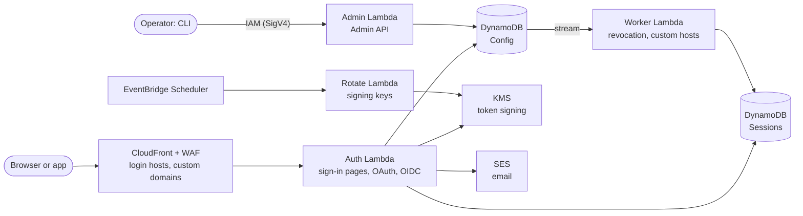

# LiteLogin

A multi-tenant OAuth 2.1 and OpenID Connect identity provider that runs entirely on AWS serverless services: Lambda, DynamoDB, KMS, CloudFront and SES. There are no servers to manage: costs follow requests, on top of a small fixed monthly cost for the WAF, KMS keys and monitoring. [Cost.md](Cost.md) works out the monthly cost at 1,000 to 1 million sign-ins.

One deployment serves many **orgs**. Each org has its own users, its own login hosts (`acme.login.example.com`, or a custom domain such as `login.acme.com`), and its own apps.

**Status:** pre-1.0. It's feature-complete for sign-in and has been load-tested, but expect breaking changes before 1.0.

## Features

- **OAuth 2.1 and OpenID Connect:**
  - authorization code flow, with PKCE (`S256`) required by default
  - refresh tokens, rotated on every use, with reuse detection
  - discovery, JWKS, `/userinfo` and RP-initiated logout
  - an issuer per login host
- **Sign-in pages:** registration, email verification, password reset, passkeys (WebAuthn), account settings (change password or email, manage passkeys, sign out everywhere), and per-host theming.
- **Multi-tenant:**
  - orgs, user pools, clients and login hosts
  - single sign-on across the clients on a host
  - custom domains with managed certificates
- **Security:**
  - signing keys that never leave KMS, rotated automatically
  - argon2id password hashing, and account lockout
  - immediate revocation of sessions and refresh tokens
  - WAF rate limiting
  - signed, reproducible Lambda packages
- **Operations:**
  - a CLI and an IAM-authenticated Admin API
  - Terraform/OpenTofu modules for the whole deployment
  - CloudWatch dashboards and alarms

## Quickstart

You need an AWS account used only for LiteLogin, a domain for login hosts that you can delegate to Route 53 (such as `login.example.com`), OpenTofu or Terraform, Go and the AWS CLI. The first deploy takes about 30 minutes, mostly waiting for the certificate and CloudFront.

```sh
git clone https://github.com/litelogin/litelogin && cd litelogin
AWS_PROFILE=<your profile> scripts/deploy.sh prod --domain login.example.com
dist/litelogin init --org "Acme" --client "Acme Portal" --redirect-uri https://app.acme.com/callback
```

`deploy.sh` creates the environment, shows each plan before applying it, tells you which NS records to add for the domain and waits for them, then checks the deployment with `litelogin status`. If it stops, run it again: it continues where it left off.

With [Claude Code](https://claude.com/claude-code), you can ask for it instead: open Claude Code in the repository and say "deploy LiteLogin to my AWS account". The `litelogin` skill in `.claude/skills` runs `deploy.sh`, brings you each decision (the account, the NS records, every plan before it's applied), and then helps with creating orgs and clients, finding what's wrong, upgrades and removal. See [SelfHosting.md](SelfHosting.md#with-claude-code).

`init` prints an issuer URL, a client ID and a client secret. Point any OpenID Connect library at the issuer: it finds the rest through `/.well-known/openid-configuration`. `litelogin client test` signs in end to end, as an app would. [SelfHosting.md](SelfHosting.md) has every step in full.

## How it works



Every request is handled by a Lambda function and all state is in two on-demand DynamoDB tables, so there's no capacity to provision or servers to patch. Besides requests, only scheduled jobs run: key rotation daily, and a reconciler every 5 minutes. Signing keys are created in KMS and never leave it. [Architecture.md](Architecture.md) explains each part.

## Documentation

- [SelfHosting.md](SelfHosting.md): deploy LiteLogin in your own AWS account
- [Architecture.md](Architecture.md): how it works
- [Datamodel.md](Datamodel.md): the DynamoDB tables and every access pattern
- [Cost.md](Cost.md): the monthly cost on AWS, fixed and per request
- [ThreatModel.md](ThreatModel.md): threats, controls and accepted risks
- [CONTRIBUTING.md](CONTRIBUTING.md): building, testing and the code layout
- [test/load/README.md](test/load/README.md): load testing, and measured results

## Try it locally

You need Go and Docker.

```sh
make local-up local-tables   # DynamoDB Local, with the tables
make run-auth &              # the sign-in endpoints, on :8080
make run-admin &             # the Admin API, on :8081
make cli
dist/litelogin --endpoint http://localhost:8081 init --org Acme --client "Acme Portal" \
  --redirect-uri http://localhost:3000/callback
```

Then open <http://acme.litelogin.localhost:8080/login>. CONTRIBUTING.md has the details.

## The CLI

`litelogin` manages a deployment through the Admin API, signing each request with your AWS credentials:

```sh
dist/litelogin configure --profile <profile> --environment <environment>   # find and save the endpoint
dist/litelogin init --org "Acme" --client "Acme Portal" --redirect-uri https://app.acme.com/callback
dist/litelogin org list
echo "$PASSWORD" | dist/litelogin user create --pool POOL --email admin@acme.com --password-stdin
dist/litelogin client test CLIENT      # sign in through the browser, as the client's app would
dist/litelogin host add --org ORG login.acme.com
```

Every command takes `-o json`, and `litelogin help` lists them all. SelfHosting.md covers access control and custom domains.

## License

MIT; see [LICENSE](LICENSE).
