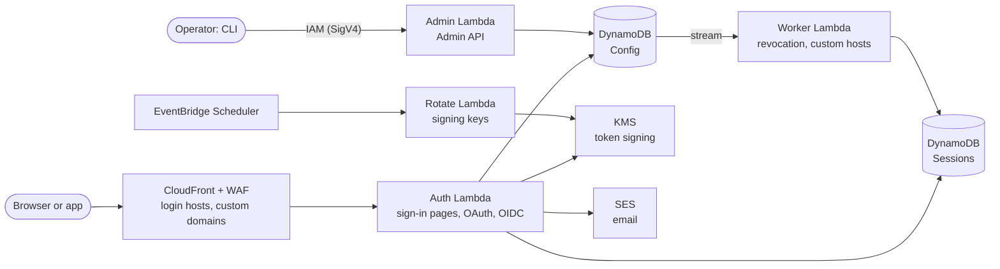

# LiteLogin

A multi-tenant OAuth 2.1 and OpenID Connect identity provider that runs entirely on AWS serverless services: Lambda, DynamoDB, KMS, CloudFront and SES. There are no servers to manage or capacity to provision.

One deployment serves many **orgs**. Each org has its own users, its own login hosts (`acme.login.example.com`, or a custom domain such as `login.acme.com`), and its own apps.

**Status:** pre-1.0. It's feature-complete for sign-in and has been load-tested, but expect breaking changes before 1.0.

## Features

- **OAuth 2.1 and OpenID Connect:**
  - authorization code flow, with PKCE (`S256`) required by default
  - refresh tokens, rotated on every use, with reuse detection
  - discovery, JWKS, `/userinfo` and RP-initiated logout
  - an issuer per login host
- **Sign-in pages:** registration, email verification, password reset, passkeys (WebAuthn), account settings (change password or email, manage passkeys, sign out everywhere), and per-host theming.
- **Multi-tenant:**
  - orgs, user pools, clients and login hosts
  - single sign-on across the clients on a host
  - custom domains with managed certificates
- **Security:**
  - signing keys that never leave KMS, rotated automatically
  - argon2id password hashing, and account lockout
  - immediate revocation of sessions and refresh tokens
  - WAF rate limiting
  - signed, reproducible Lambda packages
- **Operations:**
  - a Claude Code skill that deploys and operates it
  - a CLI and an IAM-authenticated Admin API
  - Terraform/OpenTofu modules for the whole deployment
  - CloudWatch dashboards and alarms

## Quickstart

You need an AWS account used only for LiteLogin, a domain for login hosts that you can delegate to Route 53 (such as `login.example.com`), OpenTofu or Terraform, Go and the AWS CLI. The first deploy takes about 30 minutes, mostly waiting for the certificate and CloudFront.

The easiest way to deploy is with [Claude Code](https://claude.com/claude-code). Clone the repository, open Claude Code in it, and ask:

```sh
git clone https://github.com/litelogin/litelogin && cd litelogin
claude "Deploy LiteLogin to prod with my litelogin-prod AWS profile, using login.example.com"
```

The `litelogin` skill in `.claude/skills` runs `scripts/deploy.sh` and brings you each decision: it shows the AWS account for you to confirm, gives you the NS records to add and checks the delegation, and summarizes every plan before applying exactly that plan. When it's done, it runs `litelogin status` to check the deployment. It names the AWS profile on every command, never falls back to the default one, and asks before anything destructive. See [SelfHosting.md](SelfHosting.md#with-claude-code).

### Without Claude Code

`deploy.sh` does the same steps from your terminal:

```sh
AWS_PROFILE=<your profile> scripts/deploy.sh prod --domain login.example.com
dist/litelogin init --org "Acme" --client "Acme Portal" --redirect-uri https://app.acme.com/callback
```

It creates the environment, shows each plan before applying it, tells you which NS records to add and waits for them, then checks the deployment. If it stops, run it again: it continues where it left off. `init` prints an issuer URL, a client ID and a client secret. [SelfHosting.md](SelfHosting.md) has every step in full, including doing it all by hand.

## How it works



Every request is handled by a Lambda function and all state is in two on-demand DynamoDB tables, so there's no capacity to provision or servers to patch. Besides requests, only scheduled jobs run: key rotation daily, and a reconciler every 5 minutes. Signing keys are created in KMS and never leave it. [Architecture.md](Architecture.md) explains each part.

## Documentation

- [SelfHosting.md](SelfHosting.md): deploy LiteLogin in your own AWS account
- [Local.md](Local.md): run LiteLogin on your machine, sign in, and add a passkey
- [Architecture.md](Architecture.md): how it works
- [Datamodel.md](Datamodel.md): the DynamoDB tables and every access pattern
- [Cost.md](Cost.md): the monthly cost on AWS, fixed and per request
- [ThreatModel.md](ThreatModel.md): threats, controls and accepted risks
- [CONTRIBUTING.md](CONTRIBUTING.md): building, testing and the code layout
- [test/load/README.md](test/load/README.md): load testing, and measured results

## Managing orgs, clients and users

Once LiteLogin is deployed, keep using Claude Code to run it. Ask in your own words, for example:

- "Create an org called Acme with a client for https://app.acme.com/callback"
- "Add a public client for Acme's mobile app"
- "Create an admin user for Acme with admin@acme.com"
- "Test a sign-in with the Acme Portal client"
- "Add login.acme.com as a custom login host for Acme"
- "Rotate the Acme Portal client's secret"
- "Why is sign-in failing on prod?"
- "Upgrade prod to the latest version"

The skill uses the `litelogin` CLI, which manages a deployment through the IAM-authenticated Admin API. It shows you each client secret once and doesn't write it anywhere, and it asks before each destructive command: deleting or disabling, revoking sessions, rotating a secret, or removing a deployment. Pointing an app at a new client takes only the issuer: any OpenID Connect library finds the rest through `/.well-known/openid-configuration`.

Everything the skill does, you can do with the CLI directly (`dist/litelogin help` lists every command); [SelfHosting.md](SelfHosting.md#6-operators-and-the-cli) covers it, along with access control and custom domains. The skill itself is a Markdown file, `.claude/skills/litelogin/SKILL.md`: read it to see exactly what it does.

## License

MIT; see [LICENSE](LICENSE).
